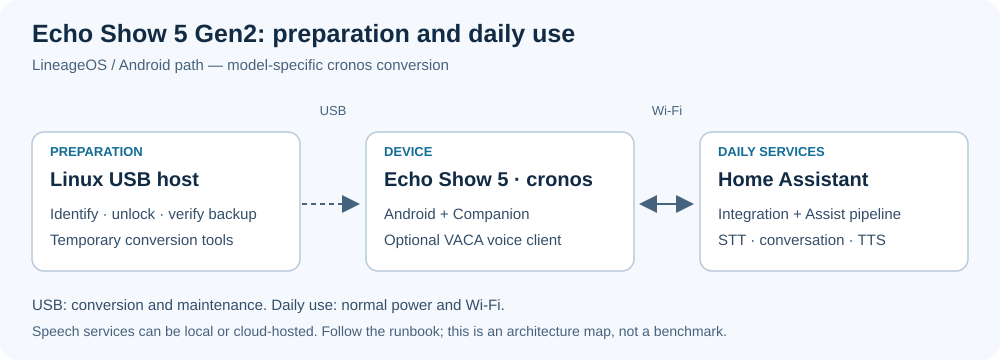
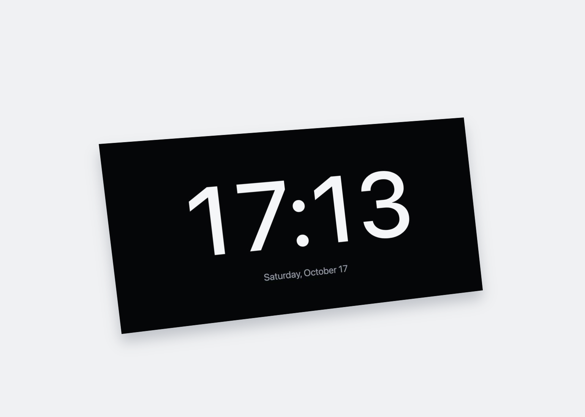
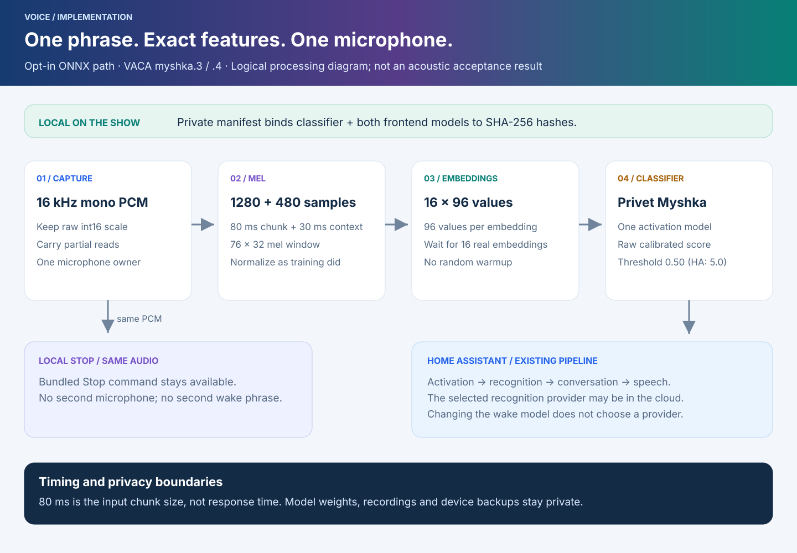

# Echo Show 5 Gen2 → Android → Home Assistant

[](https://www.bestpractices.dev/projects/15595)

[English](README.md) · [Русский](README.ru.md) · **Deutsch** · [Español](README.es.md) · [Français](README.fr.md)

Dieses Projekt macht einen **Amazon Echo Show 5 der zweiten Generation (2021), Codename `cronos`**, zu einem Home-Assistant-Sprachsatelliten, einer gut lesbaren Uhr, einem Kamera-Bildschirm bei Bewegung und einem fernsteuerbaren Medien- und Anrufgerät. Das Repository enthält Werkzeuge für den begleiteten Umbau, lokale Patches, Integrationen und Wiederherstellungsanleitungen. Firmware, APKs, private Aktivierungsmodelle und Zugangsdaten sind nicht enthalten.

Beginnen Sie im [Projekt-Wiki](docs/wiki/Home.md). Für ein unverändertes Gerät gilt die [Umbauanleitung](docs/runbook.md); für ein Gerät mit Android die [Update- und Wiederherstellungsanleitung](docs/wiki/Installation-and-recovery.md). **Ein bereits entsperrtes Gerät nicht erneut entsperren.** Die ausführlichen technischen Anleitungen werden auf Englisch gepflegt; diese Seite ist der deutsche Einstieg.




[](docs/assets/clock-screenshot.jpg)

Die echte Uhrseite `20261015-r11`, aufgenommen in Desktop-Chrome mit
960 × 480 und der Beispielkonfiguration. Ohne Home-Assistant-Anmeldung, Kamera
oder Gerät. Ein Klick öffnet das flache Original.

## 19. Oktober: zwei Aktivierungsphrasen auf Show 1

**Show 1 verwendet jetzt `myshka.7` / `7007` mit „Привет, мышка“ und „Hey Jarvis“.**
Der exakte ONNX-Pfad für Myshka behält den Schwellwert **0,50**. Für das
integrierte Jarvis muss die mittlere Wahrscheinlichkeit aus **fünf
Modellauswertungen strikt größer als 0,97** sein. Beide nutzen ein Mikrofon;
Jarvis teilt den bestehenden MicroFrontend mit Stop. Stop bleibt ein separater
Befehl zur Wiedergabesteuerung.

Der Build mit der bisherigen Signatur bestand **42 JVM-Tests**; Show 1 bestand
**sechs Android-Tests**, **drei Zyklen mit tatsächlichem Schließen und
Wiederöffnen der Mikrofonerfassung** sowie einen **App-Neustart**. Beide
Aktivierungsmodelle, Stop und die HTTPS-Authentifizierung wurden wiederhergestellt;
die Einstellungen blieben erhalten. **Show 2 ist nicht erreichbar und wurde
zuletzt mit `.4` geprüft.** Synthetische Tests und geladene Modelle belegen
keine Spracherkennung im Raum; die praktische Sprachprüfung steht noch aus.

[Zweite Phrase aktivieren oder entfernen](docs/wiki/Mixed-wake-words.md) ·
[Messungen und Prüfgrenzen](docs/wiki/Validation.md#october-19-mixed-wake-checkpoint) ·
[Verarbeitungsdiagramm](docs/assets/mixed-wake-pipeline.svg), jeweils auf Englisch.
Die fünf README-Sprachen und vier Laufzeitsprachen der Uhr bleiben unverändert.

## 19. Oktober: vorheriger Stand mit myshka.6

Bei diesem früheren Stand wurde auf Show 1 **VACA `0.13.4+myshka.6` / `7006`** mit dem bisherigen Signaturzertifikat installiert. **29 JVM-Tests** und **drei Android-Instrumentierungstests** bestanden. Beim Abspielen der vier vorhandenen privaten Testdateien entsprachen alle Schwellwertentscheidungen der Referenz. „Привет, мышка“ mit dem Schwellwert **0,50** und der separate Stop-Detektor sind geladen; die Mikrofonerfassung ist aktiv. Ein Stummschaltzyklus bestätigte das Schließen und Wiederöffnen der Mikrofonerfassung, ein normaler App-Neustart die erneute HTTPS-Authentifizierung; HA-Einstellungen, manuelle Helligkeit 255, Berechtigungen und abgesichertes ADB ohne Root blieben erhalten.

Show 2 ist derzeit weder über das Netzwerk noch in HA erreichbar; sein zuletzt geprüfter Stand ist **`.4`**. Die Backend-Prüfung lieferte eine Antwort auf eine mit nativen HA-Funktionen bearbeitete Textanfrage und lud Silero-Sprachausgabe herunter; die gesamte Serverprüfung von der Textanfrage bis zum Herunterladen der Sprachausgabe dauerte **4,481 s**. Dies belegt weder eine hörbare Antwort noch die Erkennung einer gesprochenen Phrase im Raum. **Die praktische Sprachprüfung steht weiterhin aus.** Ergebnisse und Prüfgrenzen dieses früheren Stands stehen im [Prüfprotokoll vom 19. Oktober](docs/wiki/Validation.md#october-19-current-checkpoint). Die folgenden Ergebnisse gelten für die jeweils genannten Daten und Versionen.

## 16. Oktober: Versuch mit einer ONNX-Aktivierungsphrase

### Nachbesserung in PR #69: myshka.4

**`0.13.4+myshka.4` / `7004` ist auf Show 2 installiert und lokal geprüft.** Das bisherige Signaturzertifikat bleibt erhalten, alle **18 JVM-Tests** bestehen. Show 2 bestand die gezielte Android-Regression für die Modellliste: **ein Test, fünf Metadatenfälle, 0,624 Sekunden**. Ungültige optionale Metadaten lassen eigene Modelle nicht mehr aus der Liste verschwinden; das Laden der Engine lehnt ungültige Dateien weiterhin ab. Show 2 bestand außerdem einen Zyklus mit tatsächlichem Schließen und Wiederöffnen der Mikrofonerfassung sowie einen normalen App-Neustart. Einstellungen, Helligkeit, Berechtigungen und authentifiziertes ADB ohne Root blieben erhalten. Die Prüfung des vollständigen Sprachablaufs steht aus. Bei der Prüfung am 16. Oktober war Show 1 nicht erreichbar; der damals zuletzt geprüfte Stand war `.3`. Der nachfolgende `.3`-Referenzvergleich belegt keinen erneuten Vergleich unter `.4`.

### Geprüfter Stand von myshka.3

**APK auf beiden Shows installiert; Referenzvergleich auf beiden bestanden.** VACA `0.13.4+myshka.3` / `7003` bestand **18 JVM-Tests**. Jeder Show bestand außerdem **zwei Android-Instrumentierungstests** mit **vier vorhandenen privaten Testdateien: 294 Embeddings, 234 Klassifikatorfenster und 11 positive Fenster**. Alle Schwellwertentscheidungen entsprachen der Referenz. Die Dateiwiedergabe zeichnet den Raum nicht auf und belegt keine akustische Erkennung.

Am 16. Oktober waren beide Shows ausschließlich für **„Привет, мышка“** mit dem exakten ONNX-Frontend und **0,50** (**5,0 in HA**) konfiguriert. „Hey Jarvis“ wurde aus der aktiven Auswahl entfernt; der separate Stop-Befehl bleibt. **Beide bestanden drei Mikrofon-Stummschaltzyklen mit geprüftem Schließen und Wiederöffnen der Erfassung sowie einen normalen App-Neustart.** HA-Einstellungen, Helligkeit, Berechtigungen und ADB ohne Root blieben erhalten. Gesprochene Aktivierung, hörbare Antworten, Entfernung, Stop während der Wiedergabe, Stromausfall und mehrtägiger Betrieb sind weiterhin ungeprüft. Die Funktion mit zwei microWakeWord-Modellen und der Stand vom 15. Oktober bleiben unten dokumentiert.

[Modellumstellung: Ablauf und Ergebnisse](docs/wiki/Wake-model-rollout.md) · [Technische Anleitung](docs/openwakeword-myshka.md) · [Prüfdiagramm](docs/assets/wake-validation.svg)



## Funktionen

- **Sprachgesteuerter Assist:** exakte ONNX-Erkennung von **„Привет, мышка“** mit **0,50** und optional **„Hey Jarvis“** mit eigener kalibrierter Entscheidung über mehrere Auswertungen. Der frühere Modus mit zwei microWakeWord-Modellen bleibt separat verfügbar. Private Modelle werden nicht verteilt. [Sprache und Modelle](docs/wiki/Voice-and-wake-words.md).
- **Oberfläche für fünf Zoll:** große Uhr, bildschirmfüllendes Front-/Porch-Kameravideo bei Bewegung, zeitlich begrenzte manuelle Ansicht und Rückkehr zur Uhr. Das Seitenverhältnis bleibt erhalten; Video erscheint erst mit einem verfügbaren Bild, ohne verzerrtes Android-Play-Symbol. [Bildschirm](docs/wiki/Display-media-and-calls.md).
- **HA-Fernbedienung:** Ansagen, Musik, fest konfigurierte TV-Streams, unser OTT-play-FOSS-Client auf Capacitor, ein separater OTT-Webzugang und optional OttPlayer. Home/Stop beendet die verwaltete Aktivität. [Fernsteuerung](docs/remote-endpoint.md).
- **Anrufe über die eigene Jitsi-Installation:** fester Raum, ausdrücklich gewählte Beitrittsregel, Mikrofonübergabe und Wiederherstellung nach dem Anruf. Die experimentelle HA-Gegensprechanlage ist ein gesonderter Weg. [Anrufe](docs/wiki/Display-media-and-calls.md#jitsi-and-intercom).
- **Sprachdienst auswählen:** Homeway, der unabhängige FCC-Cloud-Pfad oder lokaler Dialog und Piper mit FCC-Cloud-Spracherkennung. Die Auswahl gilt pro Satellit; es gibt kein automatisches Failover. [Umschalten](docs/wiki/Voice-and-wake-words.md#choose-and-switch-an-assistant).
- **Sprachen:** Einstiegs-READMEs auf Englisch, Russisch, Deutsch, Spanisch und Französisch sowie eine eigene Spracheinstellung für die Uhr. Bildschirm-, Erkennungs- und Aktivierungssprache sind unabhängig. [Lokalisierungsumfang](docs/wiki/Localization.md).

## Stand der Prüfung

**Geprüfter Stand vom 15. Oktober 2026:** Der gebaute Patch `dualwake.2` korrigiert die Freigabe der Detektorressourcen. Die Bildschirmversion `20261015-r11` kombiniert Englisch, Russisch, Deutsch und Spanisch mit Wiederholungsversuchen, wenn der MQTT-Befehl beim HA-Start noch nicht verfügbar ist. In **48 synthetischen Desktop-Layout-Renderings** wurden in den geprüften Fällen keine abgeschnittenen Elemente festgestellt. Beide Updates waren zu diesem Prüfzeitpunkt auf beiden Shows installiert. Jedes Gerät bestand drei softwaregesteuerte Stumm-/Lautschaltzyklen des Mikrofons und einen App-Neustart; beide Modelle und die Aufnahme wurden wiederhergestellt. Die Erkennung tatsächlich gesprochener Phrasen bleibt ungeprüft; Details stehen im [Validierungsprotokoll](docs/wiki/Validation.md).

Der dokumentierte Stand vom **14. Oktober 2026** umfasst zwei Shows mit Android 11 / inoffiziellem LineageOS 18.1. Beide Aktivierungsmodelle wurden nach einem normalen **App-Neustart** geladen, die HA-Identitäten blieben erhalten, und aufeinanderfolgende Ansagen wurden auf Dienstebene abgeschlossen. Beide Geräte verwenden **Local Russian Home** und die Stimme **Irina**. Für die Spracherkennung wird weiterhin Audio in die Cloud gesendet. [Build-Nachweise](integrations/vaca-dual-wake/README.md#historical-deployment-evidence--2026-10-14) · [Sprachkonfiguration](docs/fcc-voice-backup.md).

**Gezielte Tests beider Phrasen am Gerät, hörbare Antwortqualität, Wiederanlauf nach Stromausfall und mehrtägiger Betrieb sind für den Build `dualwake.2` noch nicht bestätigt.** Ein API-Erfolg oder geladenes Modell ersetzt diese Tests nicht. Die [Validierungsübersicht](docs/wiki/Validation.md) trennt die Prüfumfänge. Der [Umbau-Schnappschuss vom 2. Oktober](docs/preparation-status.md) ist historisch und enthält inzwischen geänderte Spracheinstellungen.

## Kompatibilität und Vorbereitung

Unterstützt wird **nur Show 5 Gen2 / `cronos`**. Images und Verfahren für Echo Dot/EchoLocal, Show 5 Gen1 oder Show 8 sind nicht austauschbar.

```text
Unveränderter cronos → amonet-cronos 2.0.1 → TWRP → geprüfte externe Sicherung
                    → LineageOS 18.1 v0.4 / Android 11 → Companion + optional VACA
```

Das Entsperren verändert die Boot-Kette **vor der ersten Sicherung**. Android ersetzt Fire OS/Alexa und erfordert das Formatieren von Daten. Die Sicherung ist kein Nachweis einer allgemein getesteten Rückkehr zum Werkszustand. Erforderlich sind das normale **Netzteil**, ein Micro-USB-**Datenkabel**, ein physischer **x86_64**-Synology-NAS mit Docker/Python 3.8+/SSH und Sicherungsspeicher, ein Rechner mit Python/SSH/rsync sowie ein erreichbarer HA-Server. USB ersetzt das Netzteil nicht. Die benötigten Dateien werden separat heruntergeladen und gemäß Anleitung geprüft.

Nach der Vorbereitung des Hosts im [Runbook](docs/runbook.md) lesen diese Befehle nur den Zustand:

```bash
python3 scripts/remote.py preflight
python3 scripts/remote.py inventory
```

Wählen Sie den **beobachteten physischen USB-Port und die vollständige Seriennummer**, niemals „den ersten Echo“. Schreibvorgänge haben eigene Befehle und Prüfschranken; das Einstecken startet keinen Umbau.

## Dokumentation und Wartung

[Wiki](docs/wiki/Home.md) · [Architektur und Cloud-Grenzen](docs/wiki/Architecture.md) · [Installation und Rückkehr](docs/wiki/Installation-and-recovery.md) · [Sprache](docs/wiki/Voice-and-wake-words.md) · [Bildschirm, Medien, Anrufe](docs/wiki/Display-media-and-calls.md) · [Fehlersuche](docs/wiki/Troubleshooting.md) · [Validierung](docs/wiki/Validation.md) · [Lokalisierung](docs/wiki/Localization.md) · [Wartung](docs/wiki/Maintenance.md).

Downloads gehören nach `downloads/`, fremder Quellcode nach `vendor/`, Sicherungen nach `backups/`, Protokolle nach `logs/`, Schlüssel, Aufnahmen und ausgefüllte Konfigurationen nach `private/`. Git ignoriert diese Verzeichnisse, entfernt damit aber keine bereits eingecheckten Daten. HA-Dateien unter `/local` sind ohne Anmeldung erreichbar und dürfen keine Geheimnisse enthalten.

[Beiträge und Tests](CONTRIBUTING.md) · [Sicherheit](SECURITY.md) · [Drittlizenzen](THIRD_PARTY_NOTICES.md) · [Releases](RELEASING.md). Ein Projekt-Release enthält Integrationsquellen, keine Firmware und keine APK. CI bestätigt weder hörbaren Ton noch die Zuverlässigkeit eines konkreten Geräts.
