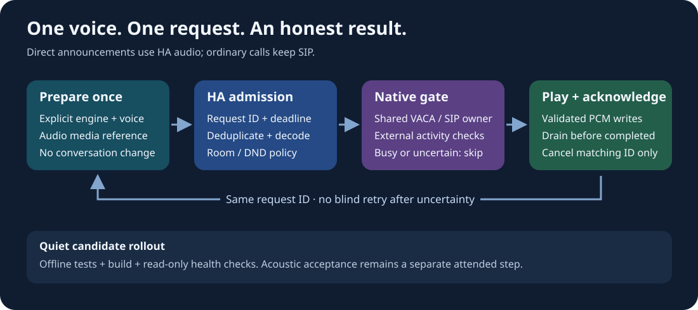

# Guarded announcements on Echo Show

Use direct Home Assistant audio for one-way announcements and keep SIP for
ordinary calls. Each physical Show retains **one** SIP account. An announcement
does not create another extension, dial a number, start a conversation, or upload
microphone audio for speech recognition.

This is a candidate integration. The [baseline validation record](../integrations/vaca-announce/build-validation-2026-10-29-r2.md)
identifies the checked baseline artifacts and quiet installation on two endpoints;
the linked PR records final live activation checks. The optional `duck_music`
extension is a separate candidate and is not validated by that baseline record.
Audible playback and room-level acoustic acceptance remain pending.
The [7014 ducking record](../integrations/vaca-announce/build-validation-2026-10-29-duck.md)
separately tracks the optional music policy. Do not enable a dispatcher until the installed endpoint reports the required
capabilities. There is no automatic fallback to an unguarded announcement.

## Synthesize once, independently of the conversation pipeline

The caller prepares a single audio file with its explicitly selected TTS engine
and voice, then reuses its media reference for the intended recipients. The Show
receives decoded PCM rather than a new text-to-speech instruction. Its selected
conversation agent, recognition service and default Assist pipeline are unchanged.

For a local Russian Silero service, `silero-ru-default` means “follow service
settings”; it does not permanently select Baya. Select `silero-ru-baya` when the
caller requires that voice regardless of later service settings. Entity IDs are
installation-specific and belong in private operator configuration.

The public Home Assistant [TTS API](https://www.home-assistant.io/integrations/tts/)
can prepare audio without playing it. The guarded API below accepts the resulting
`media_id`, with `preannounce: false`. It does not call `start_conversation`.

## Service contract

The integration uses domain `vaca`. Each service requires a response; REST callers
use `/api/services/vaca/<service>?return_response` and read `service_response`.
Check HTTP and Home Assistant errors before inspecting that response.

- `announcement_capabilities`: `{entity_id}`. This is read-only and never starts
  playback. Require protocol `cisco-announcement-v1` and all of
  `atomic_idle_guard`, `dedup`, `owned_cancel`, `honest_completion`, and
  `deadline_enforced` before enabling a dispatcher. For `duck_music`, also require
  `duck_music: true`, `duck_music_player: "vaca"`, and
  `duck_music_scope: "owned_player"`. Missing support skips that request; it does
  not silently select a different policy or unguarded route.
- `announcement_submit`: `{entity_id, request_id, media_id, expires_at,
  preannounce: false, busy_policy: "skip"}`. `expires_at` is a Unix UTC timestamp
  in seconds. `skip` remains the default. The optional `duck_music` policy allows
  supported VACA music to continue at reduced gain; it does not relax the call,
  Assist, DND, foreground or deadline checks. Submission is asynchronous;
  acceptance is not completion.
- `announcement_status`: `{entity_id, request_id}`. This is read-only and must
  never retry or create a request.
- `announcement_stop`: `{entity_id, request_id}`. This stops only the matching
  announcement. It is not a general media-stop, hangup, or Assist-cancel action.

Receipt services return `{request_id, status, reason?}` with the exact original
ID. Dispatcher-generated IDs have the shape `announce-<32 lowercase hex>-<three
digit endpoint>`. Preserve the same ID while reconciling an uncertain response.
Submitting the same ID with changed content or a different busy policy must not
replace the original job. An omitted policy means `skip`, including receipts
written before `duck_music` existed. The original `skip` fingerprints remain
compatible; changing an old request to `duck_music` is a conflict, not a retry.

Statuses are `accepted`, `playing`, `completed`, `skipped`, `failed`, `stopped`,
and `unknown`. `completed` describes successful device-side playback drain, not
proof that a person heard the sound. `unknown` requires reconciliation rather
than automatic replay. A stale request must never start after its deadline.

## What owns the audio

The native admission gate serializes participating VACA playback, Assist and SIP
activity. Busy, muted-policy, expired or unverifiable requests are skipped before
audio starts. SIP must participate before publishing an incoming ring, not only
after answering it. This avoids treating a ringing phone as an idle speaker.
An incoming call takes priority over an existing announcement: stop that
announcement's audio before handing ownership to SIP. Do not make a legitimate
call wait for a long announcement to finish.
The current SIP candidate acquires its full audio lease before showing the
incoming-call notification. An active Assist or music session that prevents that
lease can therefore cause rejection before ringing; this is a behavior change
from the earlier SIP pilot.

Android-wide exclusion is a different guarantee. A third-party application can
ignore audio focus or start outside this coordinator. Capabilities therefore
describe the guard scope separately: `guard_scope: "coordinated_vaca_sip"`,
`external_busy_policy: "observe_and_abort"`, and
`global_android_exclusion: false`. Required external observations must be
available; missing permissions or unknown activity are not evidence of idleness.
The HA room/call and do-not-disturb policy adds another admission check.

The default `skip` policy keeps its original behavior: busy music is a reason
to skip. Do not substitute `media_player.play_media(announce=true)`: the upstream
VACA media route replaces its current item and does not guarantee restoration.
A stop request retains the announcement's ownership and cannot stop a newer
call, alarm or media session.

## Optional music ducking

Request `busy_policy: "duck_music"` only after the endpoint explicitly advertises
support for that policy. This permits a temporary gain change on the existing
**VACA MusicPlayerService** player. It is not a general Android media controller:
OTTPlay, a browser, a Bluetooth source and other applications are not eligible
music owners. Their volume is never deliberately changed through the system
volume controls.

The native device checks the exact music owner and active playback observations
before admission. HA may allow a consistent local-music state through its
preliminary room check, but that does not grant native ownership. Calls, Assist,
alarms, DND, unknown activity and unsupported music still prevent admission. The
device repeats its checks during playback; additional or ambiguous activity
stops the owned announcement.

Music gain is calculated from the current user volume and an announcement-owned
attenuation token. The current candidate multiplies the player's gain by `0.2`
(20% of its requested gain, not a system-volume setting). Cleanup removes that token instead of restoring a saved
volume snapshot. Consequently, a volume change during an announcement remains
the user's chosen volume afterward. A new track on the same owned player uses
the current gain policy; destroying or replacing the player invalidates its
token. Cleanup cannot revive a stopped track or apply an old volume to a new
player. Old asynchronous volume ramps must not override this ownership.
A track change can end the announcement if playback observations become
ambiguous; the selected track and the user's current volume target are retained.

An idle endpoint can accept `duck_music`, but it does not reserve permission to
start music later. Only the player already admitted with the announcement may
continue or change tracks. A later attempt to start an unrelated music session
remains blocked until the announcement releases its gate.

Completion, explicit stop, deadline expiry, transport loss and playback failure
all attempt to release only the matching announcement's gain token. If cleanup
cannot be confirmed, the receipt stays uncertain and ownership remains
quarantined; attenuation can remain in place and further guarded work fails closed.
An incoming SIP call still preempts the announcement; music ownership must also
satisfy the SIP audio-lease rules before a call can take over.

The Android [active playback API](https://developer.android.com/reference/android/media/AudioManager#getActivePlaybackConfigurations())
provides observations, not a global application lock. The guard rejects observed
ambiguity but cannot prohibit an arbitrary application from starting later.
An announcement over owned music shares that player's existing focus instead
of issuing another focus request to attenuate other applications. Losing the
music owner's focus stops the announcement. System audio policy and arbitrary
applications still remain outside VACA's ownership. The declared scope remains `coordinated_vaca_sip` with
`global_android_exclusion: false`; this policy does not promise uninterrupted
foreign audio.

## Completion and recovery

The guarded route uses correlated request IDs for admission, PCM data and final
receipts. It must not interpret the upstream uncorrelated Wyoming `played` event
as successful completion. The previous direct path returned normally after a
missing `played` timeout, and the Android player emitted `played` even after some
errors. Neither behavior is an acceptable delivery receipt.

Decode failures, empty audio, expiry, interrupted transport and playback errors
must remain visible in the receipt. A lost response does not prove silence:
the device may have received part or all of the audio. Query the original ID and
do not mint another ID to replay it automatically. Retained deduplication records
and restart recovery protect against repeating a previously accepted request. Native terminal receipts are
retained for at least 24 hours after expiry, while active receipts are never
pruned. Atomic cleanup retains an expiry fence so clock rollback cannot revive
an original expired request. This is bounded idempotency: after retention an old
status can be unknown, and a caller must never recycle an ID with a new deadline.
When the retained journal is full, new-work capability is unavailable.

## Quiet rollout and acceptance

Build and run fake-transport, decoder and state-machine tests offline. Compare
the APK signer with the installed application, keep the previous artifact and
operator settings, and update only an idle endpoint in an agreed maintenance
window. Coordinate HA component activation; do not reboot shared HA merely to
test service registration.

During quiet hours, only inspect package versions, registration, permissions,
capabilities and unknown-request status. Do not synthesize a sample, submit media,
ring a phone or exercise a notification sound. A passing capability query is not
an acoustic test.

Attended acceptance remains separate: intelligible playback, volume, actual
completion, expiry, duplicate submission, concurrent calls/media/DND, owned
stop, connection loss and restart recovery. Record those outcomes against the
installed versions before promoting a candidate to a stable release.

For `duck_music`, also check audible continuity, user-volume changes, track
changes, pause/stop during the announcement, restoration after every exit path,
incoming SIP priority, and a second application starting audio. Confirm that
system volume is unchanged and that `skip` still skips the same busy player.

After restarting HA, allow AndroidTV and SIP setup retries to finish before
interpreting `guard_state_unavailable` as a permanent configuration fault.
Confirm each dependency is loaded and its correlated read-only status is valid.
Do not weaken the guard or repeatedly restart HA to hide a missing input.
