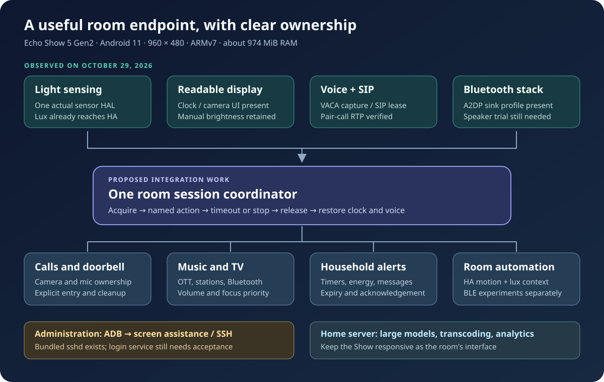

# Installed capabilities and expansion plan

[Wiki](wiki/Home.md) · [Room use cases](room-endpoint-capabilities.md) · [Remote access](android-remote-access.md) · [Permissions](android-permissions-and-limits.md)

**Audit: October 29, 2026, America/Los_Angeles.** Both already-converted Echo
Show 5 Gen2 devices were inspected through their existing authorized ADB
connections. Home Assistant's registry and states were read separately. This
is an installed-system audit, not a new firmware or application release. No
permissions, listeners, display policies or recording sessions were enabled.

The most useful next steps are remote screen assistance, a consistent room
interface, explicit ownership of microphone/camera/media sessions, actionable
household alerts, and a tested Bluetooth-speaker mode. SSH is another useful
administration route. Telnet adds no capability beyond the existing access and
a properly configured SSH service.

## Measured baseline

The [sanitized JSON snapshot](data/capabilities-2026-10-29.json) contains selected
hardware/software facts. Raw receipts stay private. A package declaration or a
granted permission is not proof that a physical feature works.

| Area | Observed on both Shows | Implication |
| --- | --- | --- |
| OS | Android 11 / API 30; `18.1-20260905-UNOFFICIAL-cronos` | Apply Android 11 behavior even when an app targets a newer SDK. |
| Build | `userdebug`, `ro.debuggable=1`, SELinux permissive; security patch field `2024-02-05` | The recent ROM date does not establish recent security patches. These flags do not give every app root. Keep administration on the trusted management path. |
| App ABI | `armeabi-v7a,armeabi`; no 64-bit ABI | New native APKs/tools need ARMv7 support. CPU architecture does not override the installed userspace ABI. |
| RAM | About 974 MiB reported RAM; 483 MiB swap | Keep large models, transcription, transcoding and analytics on a server. |
| Free resources | About 248/263 MiB available RAM and 2.42/2.46 GiB free data storage | Point samples, not an application budget or performance guarantee. Avoid several permanent media engines. |
| Screen | 960 × 480; reported density 195 | Large controls, one task per screen, full-screen camera playback. |
| Actual sensor HAL | Exactly one sensor: `Light Sensor`, `android.sensor.light`, vendor `amazon-oss` | Lux is usable. No accelerometer, compass, proximity, motion or room-temperature sensor was exposed. |
| Declared features | XML advertises accelerometer, compass, USB host, BLE and cameras | Declarations overstate observed sensor hardware. USB and Bluetooth roles need real tests. |
| Lux in HA | Both VACA Light level sensors have numeric values, unit `lx`, device class `illuminance` | Existing lux integration is confirmed; calibration was not measured. |
| Motion in HA | Motion mode `none`; wake-on-motion off | Existing motion entities and old timestamps do not prove active detection. |
| Display policy | Manual brightness 255; auto brightness off; double-tap wake on; ambient always-on display off | Retain readable manual control. Any lux policy needs a separate opt-in, minimum brightness and manual override. |
| Bluetooth | Adapter on; `A2dpSinkService` in the stack | Phone-audio reception is promising. Pairing, playback and voice coexistence were not tested. |
| Thermal API | HAL not ready; no cached temperatures | Thermal status zero is not evidence of a cool device or room-temperature sensing. |
| ADB | Authorized shell UID 2000; `ro.adb.secure=1`; persistent TCP5555 | Existing administration works; legacy TCP ADB key authentication does not encrypt transport. |
| Wireless-debug TLS | `adb_wifi_enabled=0`; TLS port/property empty | Android 11 pairing support must not be confused with the active legacy connection. |
| SSH | Bundled `ssh` and `sshd`; client reports OpenSSH 8.3p1 / BoringSSL; no sshd process or TCP22 listener observed | Audit the existing daemon before adding another one; no SSH login or boot recovery was accepted. |
| Telnet / Termux | No `telnet`/`telnetd` on inspected PATH; no Termux or Termux:API package | No standard Telnet installation or Termux app was found in the inspected locations; this is not a filesystem-wide service audit. |
| WebView | `com.android.webview` 146.0.7680.153 | Record WebView independently of the old OS patch field. |

The installed `/system/etc/ssh/sshd_config` disables password authentication and
references host/authorized keys under `/data/ssh`. That directory is owned by
root with group shell and mode 0750; the audit did not read private host keys.
No matching SSH service declaration was found in the inspected system/vendor
init files. See the [SSH assessment](android-remote-access.md#bundled-openssh-inspect-before-adding-another-server)
for why binary presence alone does not establish an operational service.

## Installed apps and accepted work

Both have VACA **`0.13.4+myshka.10-sip.1` / 7010**, native Show SIP **0.1.0**,
Jitsi **26.0.0**, official HA Companion **2026.8.4-minimal**, and Android IP
Camera **0.14.0**. Show 2 additionally has OTT-play FOSS
**1.1.42-show5.2**, its native preview **0.2.1-preview**, and VLC **3.7.1**.
Those player packages were not present on Show 1. App-set parity is therefore a
specific future deployment task, not something already established.

The earlier October 29 [SIP pilot, commit `630969d`](https://github.com/ha-homelab/ha-echo-show-5/pull/115)
verified individual echo calls and a real HA-controlled pair call: incoming
ringing, decline, answer, bidirectional G722 RTP and remote hangup. Both ended
without a call or audio lease, with VACA the sole unsilenced recorder. Wake-model
files and HA pairing matched their backups. This later audit again found both
SIP endpoints registered and idle. That implementation remains a separate PR;
this documentation change does not publish its APK or declare a stable release.

Incoming PBX identity did not match the saved contact, but explicit
answer/decline worked. Remote rejection appears as `call_failed` on the caller,
with media released and redial available. Human acoustic quality, long-term
uptime and concurrent Jitsi/SIP operation remain unaccepted.

Permissions are not identical between apps or devices. VACA has microphone
access and system-setting app-op access on both, but camera access is denied.
Companion has camera/microphone grants on Show 1, while both are denied on
Show 2. Jitsi has both grants. No accessibility or notification-listener service
is enabled. See the [full grant matrix](android-permissions-and-limits.md).

## Priority order

1. **Remote screen assistance.** Trial host-side scrcpy over authorized ADB,
   initially without audio capture. Verify control, orientation, clean exit
   and VACA continuity. It directly addresses difficult five-inch settings.
2. **One room-session owner.** Extend the microphone-lease concept across SIP,
   Jitsi, camera publishing, announcements and media. Preserve the previous
   activity and volume; set deadlines; release resources and restore clock and
   voice after exit/failure. This requires new integration work: today's SIP
   lease does not coordinate every app.
3. **Named HA actions.** Provide `show_camera`, `join_home_call`, `play_station`,
   `open_ott`, `announce`, `stop`, and `return_to_clock` through typed controls
   with allowed destinations and explicit sessions. Avoid exposing an arbitrary
   shell as the household interface.
4. **Room information and alerts.** Add compact weather/energy/heating cards,
   doorbell acknowledgement, a family message board and timed reminders. Use
   existing HA data. Expire overlays and restore the previous activity.
5. **Bluetooth speaker trial.** Test the existing A2DP sink with one selected
   phone, including reconnect, volume, app restart and wake/call priority.
   Profile presence is not acceptance and does not require another recorder.
6. **Lightweight scripts and file transfer.** Assess bundled SSH first; compare
   it with ARMv7 Termux/OpenSSH for app-owned jobs and SFTP. Choose a maintained,
   authenticated service under a clearly identified Android user.
7. **BLE and camera experiments.** Beacon detection, a Bluetooth proxy and
   camera-based presence need separate software, permissions and resource
   tests. Trial one role on one Show. Existing HA motion sources remain useful
   for camera switching without starting another local detector.

The [room capability matrix](room-endpoint-capabilities.md) develops these
options, including local timers, notification actions, media receivers,
telemetry, offline behavior and USB-accessory experiments.

## Boundaries that matter

- **Lux is not occupancy.** A falling reading may mean a lamp changed or the
  sensor was covered. Keep lux contextual and do not restore unwanted dimming.
- **Bluetooth roles differ.** A2DP sink, BLE scanner, advertiser and HA proxy
  need different software and acceptance tests.
- **SSH cannot add hardware.** It supplies no missing HAL, codec, Google Play
  certification or arm64 ABI. Userdebug/permissive is not a universal grant.
- **Minimal Companion is not a full Google-services environment.** Verify its
  notification/background route; do not assume Firebase or Chromecast receiver
  functionality.
- **Synthetic battery is not a UPS.** Do not derive backup runtime or real
  battery health from this ROM's artificial readings.
- **USB host declaration is not a wiring/power test.** Audio, storage, Ethernet,
  keyboards and radio adapters need host-mode/driver/power validation. The
  recommended first steps require no new accessory.
- **Permissions need a function.** A notification listener is not needed merely
  to receive HA notifications. Accessibility is not needed for our own explicit
  app actions. Broad storage is not needed to play a network stream.

## Acceptance for each selected extension

Record the app/version/signing source, changed settings and reversal steps.
Require the existing clock, manual brightness and selected wake models to work
after exit. Requested microphone/camera sessions must be visible, bounded and
closed; network loss must not replay stale calls, reminders or camera sessions.
Verify an app restart before a separately scheduled device reboot, and measure
resources with the intended simultaneous workload. A manifest boot receiver
alone is not evidence of recovery.

The audit used build properties, package metadata and runtime grants, sensor
and Bluetooth services, device policy, thermal state, ordinary `dumpsys audio`,
socket listeners, memory/storage and read-only HA metadata. It did not use
`dumpsys media.audio_flinger`, which is known to crash this ROM's audio HAL.
External platform sources and narrower acceptance procedures are linked in the
three companion guides at the top.
