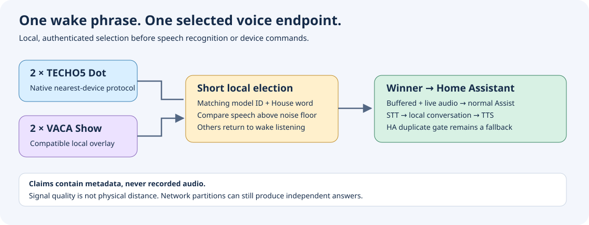

# One voice response across Echo Dot and Echo Show

The VACA nearest-device overlay is designed to let converted Echo Show devices
participate in TECHO5's authenticated, pre-pipeline voice election. Each device
measures the wake phrase against its own microphone noise floor. The winning
device starts Home Assistant Assist; the other devices remain available for the
next wake. Audio stays on each device until a winner starts its normal Assist
pipeline.

This is a signal-quality choice, not a physical distance measurement. Room
acoustics, television audio, microphone processing and microphone placement all
matter. A device with the highest comparable speech-to-noise score wins; a
calibrated offset can compensate for persistent differences between hardware.

## Two coordination layers

1. **Local election:** TECHO5 and the VACA overlay exchange authenticated wake
   claims during a short window. The active wake model identifiers must match.
   No recording or transcription is included in a claim.
2. **HA duplicate suppression:** the Home Assistant instance compares the exact
   advertised wake phrase and rejects repeated starts within two seconds before
   STT. This is a secondary first-arrival filter, not the nearest-device election.

Matching the visible wake phrase alone does not make applications interoperable.
The local election needs the same protocol version, House word, model identity,
reachable peer endpoints and sufficiently synchronized clocks. The HA fallback
also requires an exact phrase match, including punctuation and suffixes.

## Preserve the working assistant

The overlay builds on the pinned private-model VACA frontend and the existing SIP
microphone lease bridge. It does not replace wake model weights, change thresholds
or change the assistant backend. Installation must preserve the existing app
signature and app data. Never uninstall VACA as an update step.

Election work must not block the microphone reader: a bounded memory buffer keeps
speech spoken immediately after the wake phrase until the winner can forward it.
Losing buffers are discarded. Microphone mute, service shutdown and a SIP lease
must cancel any pending election. A cancelled election must never later start an
Assist turn.

Manual starts and follow-up turns have different semantics from a new acoustic
wake. They must not masquerade as another detection of the primary wake model.
Any auxiliary acoustic model must report its own identifier.

## Network and privacy

Keep House words and device configuration in private app storage. Never put them
in a repository, build receipt, screenshot, URL, command argument or diagnostic
log. Device names and protocol version may be advertised for discovery; possession
of a discovered name does not authenticate a peer.

Only accept authenticated, current, recipient-bound claims and replies. Bound
message sizes, active peer counts, replay caches and concurrent work. Do not
follow redirects or fetch arbitrary discovery URLs. Network failure should leave
an available standalone assistant, with diagnostics clearly distinguishing an
uncoordinated answer from an authenticated election win.

## Acceptance

- Check the installed APK identity, signature, model selection and assistant
  pipeline before and after updating one Show.
- Verify the Kotlin wire implementation against independent Go-generated protocol
  vectors and verify score behavior on synthetic PCM, without recording the room.
- Exercise delayed and simultaneous contenders, ties, replay rejection, stale
  timestamps, invalid signatures, an already-answering peer and network failure.
- Verify that a losing Show starts no Assist pipeline and plays no error tone.
- Check manual starts, continuation, mute, SIP preemption and service restart.
- Repeat a real wake from positions close to each endpoint and from an overlap
  position. Compare authenticated winner/yield logs with the actual HA runs.
- One audible response by itself is insufficient: only one microphone may have
  heard that trial. Peer discovery alone is also insufficient.

The original TECHO5 devices continue using their native election; the new VACA
implementation must be evaluated against that actual protocol, not only against
another copy of itself. A successful build or an HTTP health check does not prove
acoustic selection on four physical microphones.

## Source and build

The reproducible overlay and build entry point live in
[`integrations/vaca-nearest`](../integrations/vaca-nearest/README.md). Private APKs,
signing material, per-device configuration and deployment evidence are excluded
from source releases.

## Maintaining a public fork

A maintained VACA fork is a reasonable next step when private-wake, SIP and
arbitration changes are developed together. Retain an upstream remote and Git
history, keep local changes isolated, run the regression suite on upstream
updates and use a distinct release name. TECHO5 can remain an upstream dependency
with a pinned interoperability contract; this feature does not require replacing
its whole codebase.

The reviewed VACA source is Apache-2.0 and TECHO5 is MIT. Both permit modified
redistribution subject to their conditions. Preserve license texts, copyright
and attribution notices; retain VACA's NOTICE and mark changed source files.
Do not imply upstream endorsement. Check the separate licenses of bundled
models, firmware, libraries and the AGPL SIP application before distributing
binary packages. The [component notices](../THIRD_PARTY_NOTICES.md) identify the
source licenses; they do not grant additional rights to unrelated artifacts.
