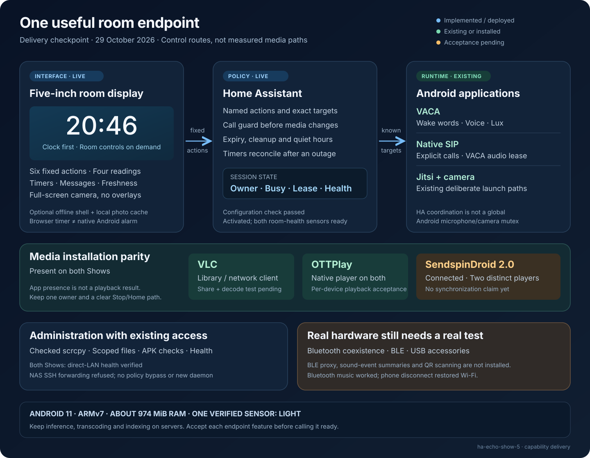

# Room endpoint capability delivery

Checkpoint: **2026-10-29**. This document reconciles the complete expansion list
with implementation and observed deployment state. A source feature, an
installed application and a working physical feature are different results.

The room packages passed HA configuration validation and were activated by one
coordinated restart. Both VACA options now point to the new room display with
`20261029-r14` assets. Both displays now show the new clock, and both HA room-health sensors report
ready. Camera acceptance passed on both; timer acceptance was performed on Show two. Show one recovered
from the Bluetooth-related Wi-Fi outage after the phone disconnected; the radio
coexistence limitation remains open. Existing voice and call acceptance stays
separately scoped.

## What has changed

- The room package adds fixed actions, native-call guards, bounded ownership,
  quiet-hour announcement checks, expiring messages, timer outage reconciliation,
  status and optional presence fusion. It reuses the existing endpoint queue.
- The display adds six large buttons, four readings, HA reminders, local timers,
  freshness indicators and an optional offline static page/photo cache. Automatic
  motion checks fresh room ownership and does not replace an open Room menu.
  Camera startup preserves the current interface until the first decoded frame;
  failure is silent and a working stream survives competing automatic motion.
- VLC and native OTTPlay now have installation parity on both Shows.
  **SendspinDroid 2.0 is connected on both**, with distinct player names. A bounded
  Show-two transport test received OPUS at 48 kHz stereo over the direct LAN;
  human listening and synchronized multiroom acceptance remain pending.
- The administration tool adds a checked scrcpy route, scoped file transfers,
  APK compatibility checks and sanitized health snapshots. Direct-LAN health
  snapshots succeeded on both devices. An eight-second Show-one scrcpy capture
  verified H.264 screen transport at 960 × 480. The NAS refused SSH forwarding;
  its policy was not changed.

The source suites and a synthetic Chrome session verify display logic, layout,
fixed actions, timer persistence and offline reload. They do not establish
audible playback, radio reception or an Android cold start.

## Status vocabulary

- **Implemented / deployed:** source, relevant automated checks and live
  activation exist; the row identifies which physical acceptance is outstanding.
- **Installed / pending:** Android confirms the application is present; setup,
  decoding, sound, synchronization or recovery has not yet been demonstrated.
- **Existing / scoped:** the repository already contains the feature or earlier
  acceptance; this delivery does not silently renew that result.
- **Physical test pending:** a phone, beacon, sensor, accessory or attended
  observation is required. A permission grant is not a substitute.
- **Not implemented / not enabled:** an extension remains outside the delivered
  runtime. The row explains the next useful step.
- **Unsupported in this inventory:** the current hardware/ROM inventory does
  not expose the required capability.

## Complete capability register

| Capability from the expansion list | Delivered state at this checkpoint | Remaining acceptance or boundary |
| --- | --- | --- |
| Room clock and status | **Implemented / deployed.** Large default clock; optional room panel, four readings, transport freshness and a current timer. | r14 clocks are visible on both; the room layout is verified on Show two. Long-term brightness checks remain. |
| Front-door camera and doorbell | **Existing + implemented / deployed.** Existing Front/Porch stream path; fixed manual actions; fresh idle-owner and menu guards for automatic motion; expiring visual messages can accompany an event. | Real streams passed the silent-transition check on both Shows; a browser-scoped network failure was also checked on Show two. A dedicated doorbell binding is still required where no existing event maps to it. |
| Room actions | **Implemented / deployed.** Six configured buttons, with fixed endpoint, light, climate, scene, script or timer actions. Requests carry no arbitrary shell or service input. | Confirm each selected household binding affects the intended room. |
| Voice control | **Existing / scoped.** Existing VACA wake-word and Assist configuration is retained. Typed room scripts provide deterministic targets for HA. | New voice exposure and actual spoken requests require their own mapping and attended test; new scripts alone do not make an LLM call them correctly. |
| Phone endpoint | **Existing + implemented / deployed.** Native SIP and Jitsi paths remain; HA media/display commands gain a fresh native-call guard. | Prior SIP checks covered bidirectional G.722 and return to VACA. This is not an Android-wide mutex; simultaneous independent SIP/Jitsi operation remains unaccepted. |
| Announcements | **Implemented / deployed.** Bounded TTS request, expiry at execution, quiet hours, idle-player checks and no automatic volume/mute changes. | TTS is bound to the existing provider. Verify one short audible message, busy rejection and cleanup. No emergency-delivery guarantee. |
| Timers and reminders | **Implemented / deployed.** Serialized HA set/cancel/expiry, absolute deadlines, startup overdue reconciliation and dismissible messages; local browser timer journal. | Live HA set → expiry → visual reminder → dismiss passed on Show two; restart reconciliation is covered by template tests. Browser chimes require a live page, usable audio and idle ownership; a native OS alarm is not implemented. |
| Lux-based context | **Existing sensor + implemented display binding.** Reuse the numeric VACA illuminance entities already present on both Shows. | No duplicate collector or automatic dimming is enabled. Choose room automation thresholds only after a controlled light/dark test. |
| Device health | **Implemented; both direct-LAN device receipts.** Sanitized Android health command; HA entity/session health and display freshness are implemented. | Interactive navigation was checked through Android input and UI readback; scrcpy screen transport was checked on Show one. Reachability and entity availability do not prove voice or media quality. |
| Heating/energy glance | **Implemented / deployed.** Selected HA states, climate current temperature/setpoint and weather attributes fit four compact readings. | Confirm room/unit bindings; energy/tariff/solar views use existing HA data, not a new Show sensor. |
| Presence fusion | **Implemented / optional configuration.** OR-combined existing binary sensors, vacancy hold and conservative unknown availability. | Bind the correct room sensors. Lux, stale motion timestamps and a paired phone are not occupancy proof. |
| BLE beacon scanner | **Physical test pending; not configured.** No selected iBeacon or other opt-in beacon has been supplied. | Select a real target, verify the installed scanner path, required permissions, reception and expiry. No broad background scanner is enabled. |
| BLE sensor proxy | **Not installed; physical test pending.** Android proxy candidate and compatibility requirements are documented. | Verify an ARMv7 artifact, select one real sensor, enable authenticated/encrypted transport where supported, then test screen-off, reconnect and reboot. |
| Bluetooth speaker receiver | **Observed profile + implemented settings entry.** Both ROM inventories expose A2DP sink service; a fixed action opens Bluetooth settings. | The user confirmed iPhone pairing and music playback on Show one. Wi-Fi then became unreachable and recovered only after phone-side Bluetooth was disabled, at the same IP. Keep this route experimental; stopping music alone did not restore networking. Reconnect and call/audio-focus recovery remain unaccepted. |
| Music/radio/OTT | **Existing + installation parity.** VLC and native OTTPlay are installed on both; existing VACA music and fixed TV/player actions remain. | Test a real stream and Stop/Home on each device. Installation does not prove codec support or absence of stalls. |
| Photo/info frame | **Implemented / optional.** Up to twelve explicitly configured same-directory JPEG/PNG/WebP images, bounded cache and readable clock; room-state information cards. | No album is enabled by default. HA `/local` is publicly readable; use appropriate images. A calendar-feed integration is not supplied. |
| Local room camera | **Existing / scoped.** Existing camera application/pilot remains separate from outdoor-camera viewing. | Explicitly start and stop a stream, verify camera release before Jitsi, and retain privacy controls. No always-on recorder is added. |
| Sound-event detection | **Not implemented.** No extra microphone recorder or uncalibrated sound-pressure sensor is introduced. | Extend the existing VACA PCM pipeline if needed; define event labels, false-alarm tests, privacy behavior and CPU budget first. |
| Physical shortcuts | **Not implemented as new key remapping.** Existing hardware volume/privacy functions are retained; room actions are available through the panel/HA. | A foreground-only gesture or selected remote can be added after key behavior is measured without disrupting normal volume or mute. |
| QR/visual workflows | **Not implemented.** No scanner application or continuous camera workflow is enabled. | Select a deliberate scan use case, verify camera ownership and return to the previous room mode. |
| USB/Bluetooth accessories | **Physical test pending.** No keyboard, audio adapter or other accessory has been enumerated in this delivery. | Check actual host mode, available power, driver/profile and recovery with the intended accessory. Generic feature flags are insufficient. |
| On-device AI server | **Not enabled; server offload retained.** The Show remains an input/display/wake-word/media endpoint. | Heavy ASR, LLMs, analytics and transcoding belong on the existing server infrastructure; no new model server competes for approximately 974 MiB RAM. |

## Protocol and administration extensions

| Requested route or protocol | Delivered state | Boundary and next step |
| --- | --- | --- |
| Multiroom Sendspin | **Connected on both; bounded transport checked on Show two.** Distinct player names, fixed launch/cleanup route and pinned artifact record; MA 2.10.8. | A 10.92-second test recorded 870 received chunks, 370 played, no dropped chunks or underruns, then restored the idle empty queue and original volume. Human-rated sound, synchronized playback, screen-off and call handoff remain unaccepted. |
| Snapcast alternative | **Not installed.** Remains an alternative if the Sendspin trial exposes a concrete need. | Avoid running duplicate background music clients without an acceptance reason. |
| AirPlay into the home audio system | **Enabled for Show two only.** Music Assistant on the NUC hosts one AirPlay Receiver mapped to the verified Sendspin player. | One healthy receiver daemon and its target mapping were verified. iPhone playback remains a physical test; expected buffering is about five seconds. This does not create a native Android AirPlay receiver. |
| NAS music/video | **Client installed; launch implemented.** VLC is available on both and a fixed Library action opens its browser. | Configure the intended SMB/UPnP/DLNA source inside VLC and test credentials, throughput, codec and Stop/Home. No share credentials are published or automatically imported. |
| MQTT telemetry / commands | **No new Android agent.** Existing VACA/HA entities supply current telemetry; typed room scripts supply commands. | Add a broker client only for an unmet integration need, with topic authorization, expiry and acknowledgements. No retained start/call command is introduced. |
| Remote screen control | **Implemented; screen transport verified on Show one.** Checked, bounded scrcpy session, 960-pixel size limit, 15 fps and no audio capture by default. | Use a permitted direct-LAN route or an explicitly allowed SSH tunnel. A health read does not establish screen/input acceptance. |
| SSH and SFTP on Android | **No new daemon.** Existing authenticated host administration plus scoped ADB file transfer handles current tasks. | Bundled SSH binaries do not imply a configured or running SSH server. The NAS currently prohibits the attempted forwarding route; direct LAN mode is explicit, not a silent fallback. |
| Telnet | **Not enabled.** No working Telnet service was established by the inventory. | It adds no needed function beyond the existing administration path. There is no claim that a missing PATH entry proves every possible binary is absent. |
| VNC / RDP | **Not installed.** scrcpy is the implemented Android screen route. | A separate client/server role would need a concrete destination, authentication and screen-size acceptance. SSH installation alone supplies neither protocol. |
| Camera RTSP / ONVIF roles | **No new server.** Keep the existing explicit camera pipeline. | A camera permission grant is not an RTSP or ONVIF implementation. Verify any future protocol endpoint and its teardown independently. |
| APK and file maintenance | **Implemented.** Package/hash/API/ABI checks, ordinary same-signer updates, dedicated Downloads transfer directory and private output receipts. | Android still enforces signing and app permissions. Shared-storage transfers are not app-private backups; this is not a firmware conversion tool. |

## Hardware and permission boundaries

The measured runtime is Android 11 / API 30 with a 32-bit ARMv7 application ABI.
Only **LIGHT** is present in the actual sensor inventory. Generic feature flags
do not establish working accelerometer, compass, proximity, room temperature or
humidity sensors. The thermal HAL is not ready; a zero status is not a temperature
measurement. IR, Zigbee, Thread and a new Matter-controller radio role are not
supplied by this work.

No new root access, firmware unlock, blanket permissions, accessibility service,
notification listener, permanently discoverable Bluetooth mode, camera recorder
or public debug listener is added. The existing legacy ADB LAN connection remains
unencrypted on its LAN hop. The administration tool verifies an exact device and
does not bypass the user's Android debugging approval.

## How to finish acceptance

1. Verify every selected room action against its intended household target. Both
   r14 clocks and the HA packages are live; no further Core restart is needed.
2. Extend the completed Show-two timer check to Show one, then test one audible
   announcement, native-call rejection and recovery. Keep the
   current voice configuration and manual brightness baseline.
3. Complete the remaining administration cases: a bounded Show-two scrcpy
   session and one disposable scoped shared-storage round trip.
4. Both Sendspin players are connected and the Show-two transport test passed.
   Test human-rated sound, synchronization and call handoff separately. The
   Show-two AirPlay receiver is enabled but iPhone playback remains unverified.
5. Keep the direct Bluetooth speaker route experimental after the observed
   network outage. BLE, QR, native alarms and accessory work require separate
   implementation or physical acceptance as indicated in the register.

Detailed implementation contracts:
[room panel](room-panel.md), [session policy](room-session-policy.md),
[remote administration](remote-admin-tools.md),
[existing endpoint](remote-endpoint.md),
[native SIP](../integrations/show5-sip/README.md), and
[Android baseline](android-and-home-assistant.md).

Raw device identities, credentials, private server mappings, screenshots and
deployment receipts stay in ignored private storage. This public register records
capabilities and their acceptance scope without publishing household inventory.

## Silent camera acceptance on the installed WebView

On Show two, the real Front stream left the clock visible for approximately
6.15 seconds, then displayed decoded 854 × 480 video. The frame counter advanced
from 2 to 30 during the following three seconds; no loading or error status was
visible, and End returned to the clock. A separate browser-scoped offline fault
kept the clock visible through 189 samples over 19 seconds, with no video reveal
or status overlay. Network emulation was then removed and the native-auth
connection returned to ready. This tests the installed Android WebView as well
as the independent synthetic browser suite.

After network recovery, Show one also passed: the clock stayed visible for
approximately 6.62 seconds until decoded 854 × 480 video was ready; frames
advanced from 4 to 32 over the next three seconds, with no status overlay or
premature reveal. It then returned to the clock.

## Bluetooth and Wi-Fi coexistence incident

The user paired an iPhone with Show one and confirmed audible Bluetooth music.
The Show then stopped responding on Wi-Fi. Pausing music and closing the player
app did not recover the connection; disabling Bluetooth on the iPhone did.
The Show's Bluetooth adapter remained on but reported no connected device.

The router retained the same sole DHCP reservation and active lease throughout.
After recovery, Wi-Fi reported 5200 MHz (5 GHz), approximately −22 dBm RSSI and a
433 Mbps link. Both HA room-health sensors returned to ready, and the r14 clock
was visible on Show one. These observations associate the outage with the active
Bluetooth connection; they do not establish a particular driver defect. No
router, DHCP or firmware changes were made. Avoid relying on simultaneous
Bluetooth reception and network functions until a controlled repeat test passes.
The existing network music route remains available; its radio path is different.
