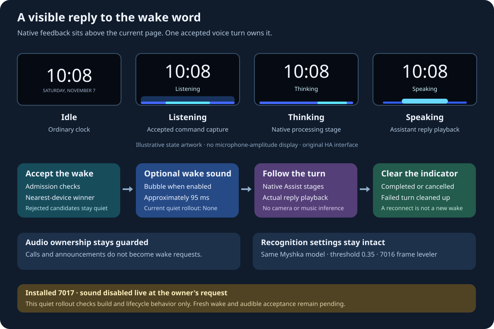

# Voice feedback on the clock screen

The installed `7017` build, `0.13.4+myshka.17-feedback.1`, adds native visual feedback
for an accepted voice request and uses the existing wake-sound setting for a
short acknowledgement. When a request starts from the clock, native
`Listening`, `Thinking`, or `Speaking` feedback appears above the existing page
without replacing it. This is an original Home
Assistant interface inspired by familiar voice-assistant states, not Alexa
software or an Amazon service.

## What starts the feedback

A raw wake-model score is not a request. The selected wake phrase must pass the
existing admission checks and, when nearest-device selection is enabled, this
Show must win the election. Only the accepted local turn can produce the
listening feedback and wake cue. A losing device stays quiet. The existing
[nearest-device protocol](nearest-device-arbitration.md), SIP audio ownership,
and [announcement guards](guarded-announcements.md) retain their roles.

The visual state follows native Assist and playback events. It does not infer
listening from camera motion, a model-candidate score, a Home Assistant connection,
or a running media player. There is no microphone-level display or new audio
capture path for the animation.

The expected sequence is:

1. An admitted local wake wins any enabled nearest-device election.
2. If a wake sound is enabled, the Show acknowledges that turn with its selected
   cue. The optional `Bubble` cue is approximately 95 ms long; `None` is silent.
3. `Listening` indicates that the accepted voice turn is taking the command.
4. `Thinking` indicates processing after command capture ends.
5. `Speaking` indicates the assistant's reply playback.
6. The completed, cancelled, or failed turn releases its indicator, leaving the
   underlying page in control of the display.

Ordinary music, camera playback, and guarded announcements are not user wake
requests. A SIP call does not acquire a listening indicator simply because its
microphone is active. Feedback must remain associated with the accepted Assist
turn and must not bypass those audio owners.

## Native display behavior

The indicator sits above VACA's current WebView. It is visible only while the
main activity is resumed, outside its settings menu and alert dialogs. It does
not open an Android system overlay, replace the clock page, or add a touch
handler. Independent motion automation can still switch the page to a camera;
voice feedback neither cancels that automation nor forces the clock back.

The bottom strip uses a 56 dp transparent-to-dark background, a 15 sp English
state label, a 4 dp blue/cyan line, and a restrained 19 dp glow. Listening uses
a 1.8-second pulse, thinking moves the highlight horizontally over 1.8 seconds,
and speaking uses a broader 2.4-second pulse. These are decorative state
animations, not measurements of speech. Disabling Android animations or enabling
touch exploration keeps the label and static indicator while removing motion.
The state is also exposed to accessibility services.

An identity-owned state machine ignores stale callbacks from a previous turn.
Stages advance without allowing late events to rewind the indicator, and
duplicate events do not extend its lifetime. Fallback visual deadlines are
45 seconds for listening, 120 seconds for thinking, and 300 seconds for speaking,
with a 420-second cap for the whole turn. They only hide stale feedback: they do
not stop playback, alter the microphone, or cancel the Assist pipeline.

The [native controller](../integrations/vaca-voice-feedback/src/main/java/com/msp1974/vacompanion/feedback/VoiceFeedbackRuntime.kt)
maps accepted local wake and manual turns to the initial listening state.
`VOICE_STOPPED`, `AWAITING_RESPONSE`, `AWAITING_TTS`, and `STARTING_TTS` map to
thinking; `STREAMING_TTS` maps to speaking; `COMPLETED_TTS` and `ENDED` hide the
indicator. A continuation inherits whether its originating turn was personal.
Server-requested announcement and TTS-only modes do not create personal-turn
feedback. Stop, microphone mute, and satellite disconnection clear the owned
indicator.

## Configure the acknowledgement

The owner requested a silent rollout while a child is asleep. Sound support is
implemented, but the live wake-sound setting stays **None** on both Shows at the
owner's request. No audible cue or acoustic acceptance test is part of this
rollout. Visual feedback remains enabled.

For a later explicitly requested audible setup, use the existing Home Assistant
wake-sound select for the individual VACA device (`wake_word_sound`) and choose
**Bubble**. **None** suppresses the wake sound while retaining visual feedback.
Device-specific entity IDs
belong in private operator configuration; do not copy an entity ID from another
Show or create a second automation that plays a duplicate cue.

The existing microphone suppression around a cue prevents the sound from feeding
back into recognition. Successful cue playback reduces that suppression to the
existing 200 ms acoustic margin after the end of the sound. Thus a 95 ms sound
does not imply only 95 ms of microphone suppression; startup latency and that
margin also matter. Validate a naturally spoken command following the cue as
part of the acoustic check.

This setting chooses the acknowledgement sound. It does not choose a wake
model, change recognition sensitivity, or replace the Assist pipeline. Keep the
selected personal Myshka model and its current threshold of **0.35**. The
[7016 built-in microphone leveler](wake-audio-2026-11-06.md) remains unchanged.
The working TECHO5 Echo Dots also retain their existing model, gain, threshold,
and settings.

Camera motion remains independent: it can show the available stream, but neither
connection attempts nor failures should produce voice-feedback labels or wake
sounds. The native indicator does not depend on camera-stream availability.
Failure of a personal voice turn clears its feedback quietly instead of adding
the previously coupled error alarm when a wake sound is selected.

## Why these states

Amazon's current [Alexa+ screen-indicator guide](https://digprjsurvey.amazon.com/csad/help/node/T2Xd07kMXxJPkWIgXD)
describes blue activity at the bottom of the screen for listening and a moving
blue wave for processing. Its listening animation follows voice amplitude;
this implementation deliberately represents state only. A decorative pulse is
not a live microphone meter. The older
[Echo screen guide](https://digprjsurvey.amazon.com/csad/help/node/TaI3C5lPJp9GBipa94)
describes a cyan spotlight on a blue listening bar.

Amazon's [Alexa Automotive attention-system guide](https://developer.amazon.com/en-GB/docs/alexa/alexa-auto/invoking-alexa.html)
explains the value of synchronized visual and audible acknowledgement and
distinct idle, listening, thinking, and speaking states. Its branded graphics
and certification rules apply to Alexa products; the Show's HA implementation
uses its own UI. The approximately 95 ms cue, English labels, and native state
mapping here are implementation choices, not a claim of Alexa certification.

Home Assistant's [Assist satellite contract](https://contributors.home-assistant.io/core/entities/assist-satellite/)
distinguishes `idle`, `listening`, `processing`, and `responding`. The last state
can also describe an announcement, so it is not by itself proof of a user voice
turn. TTS generation completion is not speaker playback completion: the native
audio lifecycle must determine when the speaking indication ends.

## Validation and rollout evidence

Both household Shows received the same signed APK on November 7, with application
data preserved. Package version and installed bytes were read back on each device.
The clock web assets remain r15; this update adds Android feedback above them.

- Package: `0.13.4+myshka.17-feedback.1` / `7017`.
- Composed source tree: `65389923a64e17c07fcecaa3529fc774c549344a`.
- APK SHA-256: `9df197497d404f2a6a653dadcf5a107a020902e7a562c27b52eebc9133b9bde7`.
- Retained signing certificate SHA-256: `2cebae957468fdb54ffaa473548e9b5f7946f84b8645e3947ff73d2af29b9850`.
- All 267 JVM tests passed without failures, errors or skips, including 17 new
  feedback-state and cue-ownership tests. All 35 build-provenance and eight
  source-distribution tests passed; the documentation validator checked 107
  Markdown/SVG files.
- One isolated Compose instrumentation test passed on Show One, covering idle,
  listening, thinking, speaking and cleanup. Four full-screen 960 × 480 captures
  were visually inspected. The fixture has a synthetic clock and Android system
  bars; it is not the deployed web clock or a physical wake-word test. Full-screen
  captures confirmed the clock remained present where a node-only capture had
  returned black. The test package and temporary device captures were removed.
- The custom model files, threshold 0.35, selected pipeline and microphone
  configuration were retained. The composed microphone implementation and all
  six 7016 audio-overlay inputs match the preceding qualified build.
- Wake sound remains **None on both Shows**, at the owner's request. No wake cue,
  speech, music, recording or other audible test was started. Optional Bubble
  support is available for later explicit selection; it was not enabled.
- Automatic recognition/pipeline error sounds were removed. A failed personal
  turn clears its indicator without scheduling another cue. Existing error
  diagnostics remain available.

Build checks and synthetic rendering establish a narrower result than acoustic
acceptance. Fresh room recognition, heard-cue quality, speech immediately after a
cue and competing-satellite behavior remain untested in this quiet rollout. Keep
the preceding signed 7016 APK for recovery; do not clear pairing, model files or
announcement journals to install an update.

Attended acceptance should check the audible cue and visual transition after
the actual wake phrase, a normal command and response, a cancelled or silent
request, and a competing nearby satellite. Camera motion may overlap the check,
but should never become the source of a voice status or a second acknowledgement.
