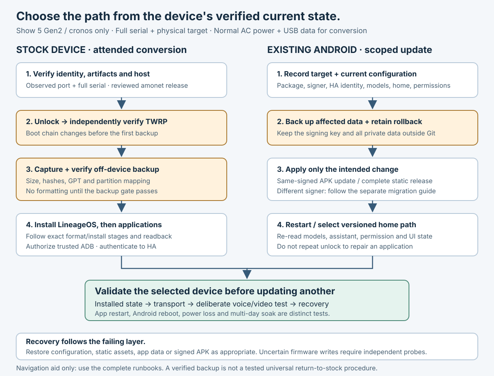

# Installation, updates and recovery

[Wiki home](Home.md) · [Full conversion runbook](../runbook.md) · [Troubleshooting](Troubleshooting.md)

Choose the procedure from the device's **current verified state**. Do not repeat firmware conversion to fix a cached page, a changed voice selection or an APK update.

## Convert a stock device

This route supports **Echo Show 5 Gen2 / 2021 / `cronos` only**. Keep the normal AC adapter attached; the micro-USB connection is for data. The complete [runbook](../runbook.md) supplies the actual commands, artifact checks, explicit write gates and recovery readback.

1. Prepare the workstation and physical x86_64 Synology host. Download and verify the pinned amonet release, ROM and application artifacts. GitHub's source ZIP is not a substitute for amonet's reviewed binary release.
2. Identify the actual USB port and complete serial, then probe stock FASTBOOT. Finish any neighboring Echo conversion first; do not stop unrelated containers or ADB servers to bypass a lock.
3. Run the attended amonet unlock and independently verify TWRP after re-enumeration. A timeout or optimistic launcher message is not successful recovery evidence.
4. Capture and verify an off-device backup **before formatting**. The first backup is necessarily after unlock; it excludes RPMB and does not establish a tested general stock restoration method.
5. Follow the runbook's explicit formatting and ROM installation stages. Verify fresh operation logs and resulting state rather than relying on exit zero alone.
6. Complete Android setup, enable USB debugging and authorize the intended host key. Verify identity again before installing Companion or optional VACA.
7. Authenticate to HA and complete [device acceptance](Validation.md). Keep original artifacts and backups private.

## Update an existing Android installation

First record the full device identity, installed package/version/signer, active HA satellite, assistant, home path, wake settings and permissions. Back up the data affected by the change. Work on one Show and verify it before moving to another.

### VACA dual-wake extension

Use the [dual-wake build and migration guide](../../integrations/vaca-dual-wake/README.md) as the authoritative procedure. The initial locally signed APK has a different certificate from upstream, so the first migration needs verified app-private backups and a controlled replacement. Preserve the original satellite UUID explicitly because Android's fallback identifier changes with the signer.

**Subsequent local builds signed by the same retained private key can update in place.** Do not automatically repeat the uninstall/reinstall migration for every update. Verify package identity, compatible version and signer before the normal update, then recheck both model loads and the existing HA connection. A mismatched key is a migration problem, not a reason to disable signature checks. Preserve the signing key and password separately in private storage.

A secondary-model configuration change only needs the private JSON file and an app restart; it is not a firmware update. Removing that file returns a healthy local build to one model. Returning to the differently signed upstream APK requires the documented backup/replacement route.

### Clock and camera page

Treat HTML, scripts, styles, poster, offline worker and configuration as one release. Copy the complete [installation file list](../../integrations/show5-display/README.md#installation) to a **new versioned directory**, with a new HTML filename and new versions on its asset URLs, then change only the intended VACA entry's home path. Include `i18n.js`, `room.js` and `offline-worker.js`; omitting them breaks localization, room controls or offline installation. The new directory also separates service-worker scopes and unversioned cache fetches. Keep the previous complete release privately. A rollback also needs a fresh release ID, since old URLs can remain cached.

Do not append the dashboard path to VACA's HA server URL. Use the reviewed `ha_dashboard` option patch described in the [clock guide](../../integrations/show5-display/README.md). Changed Python integration modules require the documented HA Core restart; a static page change alone does not. Preserve the server origin used for token refresh.

### Optional Android players

Follow the pinned artifacts and package identities in [remote endpoint controls](../remote-endpoint.md). Authorized ADB installation does not require granting a browser general permission to install unknown applications. Keep app settings, playlist credentials and command-server registrations private. Starting a package proves neither successful login nor video decoding.

## Recover according to the failing layer

- **Clock language, cache or presentation:** redeploy a complete versioned static release and restore the intended home path.
- **Voice backend unavailable:** retain the wake model and use the [per-device assistant switch](Voice-and-wake-words.md#choose-and-switch-an-assistant).
- **VACA model/configuration regression:** remove the optional secondary selection or restore the verified compatible app/private data. Preserve satellite identity and permissions.
- **Remote media/call session stuck:** use Home/Stop and verify actual app termination and microphone restoration. A timer expiring is not proof of cleanup on an unreachable device.
- **ADB unavailable:** restore power/network and use the trusted USB path. Do not weaken authentication to recover connectivity.
- **Firmware/recovery uncertainty:** stop writes and use the original runbook's independent probes. Do not replay unlock or format based only on an incomplete log.

## Record after every change

Keep a private receipt containing the artifact/source hash, signer where applicable, selected serial, previous configuration, new state, checks performed and exact rollback material. Public notes should describe the result without serials, IP addresses, access tokens, recordings or household state. An ordinary app restart, an Android reboot and removal of AC power are separate recovery tests.
