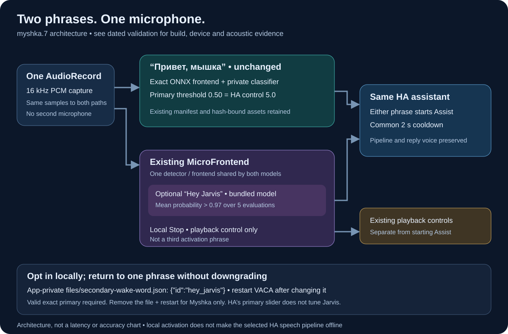

# Two activation phrases with the exact Myshka frontend

[Wiki home](Home.md) · [Voice configuration](Voice-and-wake-words.md) · [Exact frontend history](Wake-model-rollout.md) · [Implementation](../../integrations/vaca-dual-wake/README.md)

## myshka.8: two phrases with serialized listener replacement

Optional **“Hey Jarvis”**, introduced in `.7`, retains the exact ONNX path for
**“Привет, мышка.”** Either phrase starts the same selected assistant; recognition,
conversation, reply voice and display language are separate settings.

**Show 1 runs the retained-key `.8` / `7008` build with both phrases enabled.**
Its [build receipt](../../integrations/vaca-dual-wake/build-myshka.8.json) records
54 passing JVM tests. Six Android tests, live configuration changes, disabled
primary handling, three actual microphone mute/unmute cycles and an app restart
passed. See the [October 20 measurements](Validation.md#october-20-lifecycle-checkpoint).
Show 2 remains unavailable, last verified on `.4`; physical speech acceptance
remains pending. The [October 19 `.7` record](Validation.md#october-19-mixed-wake-checkpoint)
and earlier single-phrase results retain their original scope.

The listener waits for the old capture and cleanup before replacement. A cleanup
timeout retains ownership and prevents overlapping capture. Disabled selections
and unavailable OpenWakeWord primary selections stop before engine construction.
The older microWakeWord-only mode intentionally retains its available-secondary
fallback when a nonempty primary is unavailable; this does not promote Jarvis
to a primary in the mixed exact-Myshka mode. The architecture introduced in `.7`
below remains unchanged.



## One microphone, two preprocessing paths

One `AudioRecord` supplies the same PCM to both processing paths:

1. **Myshka keeps its exact ONNX frontend.** The private manifest, frontend
   artifacts and classifier stay unchanged. Its primary threshold remains
   **0.50**, represented as **5.0** by the HA control.
2. **Jarvis joins the existing local Stop path.** Its bundled microWakeWord
   model shares one `MicroWakeWordDetector` and `MicroFrontend` with Stop.
   It does not create another microphone capture or a second MicroFrontend.
   Jarvis uses the bundled calibration: the mean probability over **five model
   evaluations must be strictly greater than 0.97**.
3. **Either activation enters the existing assistant flow.** The common
   two-second cooldown applies across activation phrases. Local **Stop** remains
   a playback-control command, not a third activation phrase.

These two thresholds belong to different model families. Lowering HA's primary
threshold changes Myshka; it does not lower Jarvis's bundled gate. A value of
0.97 must not be interpreted as a measured 97% recognition rate. Five model
evaluations and an 80 ms input chunk are not end-to-end latency measurements.

## Enable or remove the optional phrase

Use a verified `.7` or later compatible build signed with the installed app's
original certificate. Do not apply this procedure to stock firmware or infer
support from a version label alone.

Keep the existing primary selection:

- Engine: `openwakeword`.
- Primary model ID: `privet_myshka_dab4a660248f_cal`.
- Primary threshold: **5.0 in HA**, effective **0.50**.
- Existing valid `files/custom/wakewords/openwakeword/exact-frontend.json`
  and its matching private assets.

The optional selection uses the existing **app-private** file
`files/secondary-wake-word.json`:

```json
{"id": "hey_jarvis"}
```

Stop VACA before changing this file, save the previous file or its absence, and
restart VACA afterward. Use authenticated access to the intended device and
the app-private storage; this file is not a Home Assistant `/local` resource.
Keep the primary engine, model and threshold unchanged when already correct.
HA's selector continues to show only the primary model; it is not a second
phrase selector.

The auxiliary is enabled only with a successfully validated exact-primary
manifest. A blank or `none` primary, unknown or duplicate auxiliary ID, or a
different generic engine does not enable this mixed path. Preserve strict
manifest and asset validation; do not bypass it to make a model appear loaded.
The older two-model **microWakeWord-only** mode is separate and retains its own
selection and shared-threshold behavior.

**To return to exact Myshka alone:** stop VACA, remove
`files/secondary-wake-word.json`, then restart and verify the exact primary plus
Stop. No APK downgrade or model replacement is required. Restore a previous
secondary file instead if that was the recorded original configuration.

## Update and acceptance sequence

1. **Snapshot the actual target.** Confirm its complete identity, installed
   version, APK hash and signer. Read current HA selections, permissions,
   brightness and private asset hashes. Preserve the currently selected
   assistant and voice rather than copying historical settings from these docs.
2. **Back up while stopped.** Briefly stop VACA, take a quiesced app-data backup,
   and verify copies on two independent hosts before installation. A backup
   copied while the app is running is provisional, not a consistent restore
   point. Retain the previous verified APK and matching signing material.
3. **Install the verified same-signer APK in place.** Check the new artifact's
   hash and build/test receipt. Do not uninstall the working application,
   format data, weaken ADB security or repeat firmware conversion.
4. **Check the new build and selection.** Run the matching targeted Android
   tests and existing private Myshka replay. Confirm both intended activation
   models load, Stop stays separate, and fresh HTTPS authentication succeeds
   with the existing certificate-validation setting.
5. **Check lifecycle and preservation.** Exercise three actual microphone
   mute/unmute cycles and an ordinary app restart. Verify capture closes and
   resumes, both activations are restored and the existing HA/display/permission
   settings remain. Restore the recorded mute state, remove temporary test fixtures and the
   instrumentation APK, and leave VACA running.
6. **Record each device independently.** An unavailable Show remains pending.
   Physical phrase recognition, audible replies, Stop during playback, distance,
   power-loss recovery and a longer soak require their own evidence.

The existing private replay fixtures exercise Myshka. They do not establish
Jarvis recognition or prove that either phrase works acoustically in the room.
Bundled-model loading and software gate tests establish narrower properties.
No new room recording is needed to perform the installation and regression
checks above.

### Android regression fixtures

Use an instrumentation APK built from the same source and signed with the same
certificate as the application. The existing `ExactFrontendParityTest` covers
manifest rejection, model enumeration and the private Myshka reference replay.
`ExactAuxiliaryParityTest` adds disabled/invalid selection and cleanup checks,
compares the shared Stop/Jarvis frontend against two independent reference
detectors, and checks Jarvis activation using explicitly staged synthetic clips.

The fixture directory is app-private `files/exact-oww-check/`. Keep the existing
Myshka `fixture.json` and reference files there, and add
`auxiliary-fixtures.json` for signed 16-bit little-endian, mono, 16 kHz synthetic
Jarvis PCM files. Its format is:

```json
{"cases": [{"id": "jarvis-voice-1", "pcm": "jarvis-voice-1.pcm", "expected": "hey_jarvis"}]}
```

The PCM names must be direct children of the fixture directory. These files
are operator-supplied test inputs, not included downloads or fresh room
recordings. With the matching test APK installed and all fixtures staged, run:

```sh
adb -s "$ANDROID_SERIAL" shell am instrument -w -r \
  -e class 'com.msp1974.vacompanion.wakeword.ExactFrontendParityTest,com.msp1974.vacompanion.wakeword.ExactAuxiliaryParityTest' \
  com.msp1974.vacompanion.test/androidx.test.runner.AndroidJUnitRunner
```

Require `OK (6 tests)` and inspect the private replay receipts. The synthetic
test requires at least one Jarvis clip to pass the bundled temporal gate; a
loaded model or a raw score above the Myshka threshold is insufficient.
Instrumentation stops the application: remove the test package and temporary
fixture directory afterward, relaunch VACA, and complete the live lifecycle
checks above. Synthetic success does not establish recognition in a room.

## Language and privacy

Project entry points remain available in English, Russian, German, Spanish and
French. The clock's implemented runtime catalogs remain **English, Russian,
German and Spanish**; this change does not add a French UI catalog. Detailed
runbooks and the shared SVG are maintained in English.

Keep `hey_jarvis` and other protocol/model IDs literal in every translation.
Speaking an English activation phrase does not switch a Russian assistant to
English. Wake detection is local, but the selected HA speech pipeline can still
send command audio to a cloud recognizer. See [voice service boundaries](Voice-and-wake-words.md#choose-and-switch-an-assistant)
and [localization](Localization.md).

Recordings, private models, tokens, device addresses, signing keys and raw
diagnostics remain outside the public repository. The SVG describes processing
roles and implemented behavior, not a new measurement.
