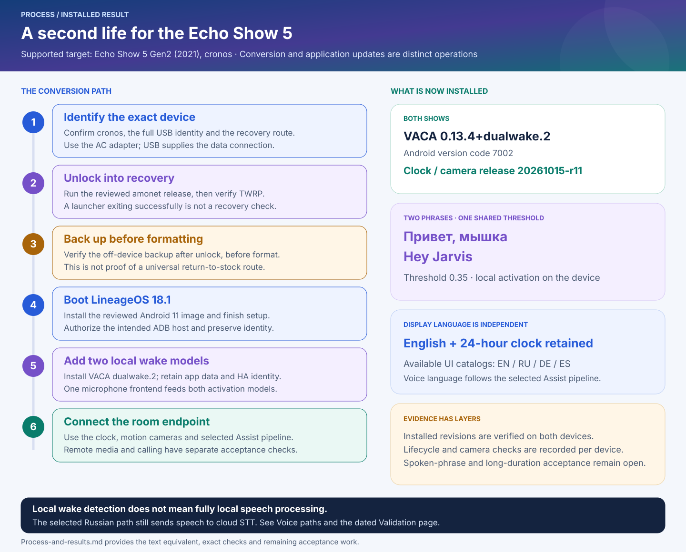
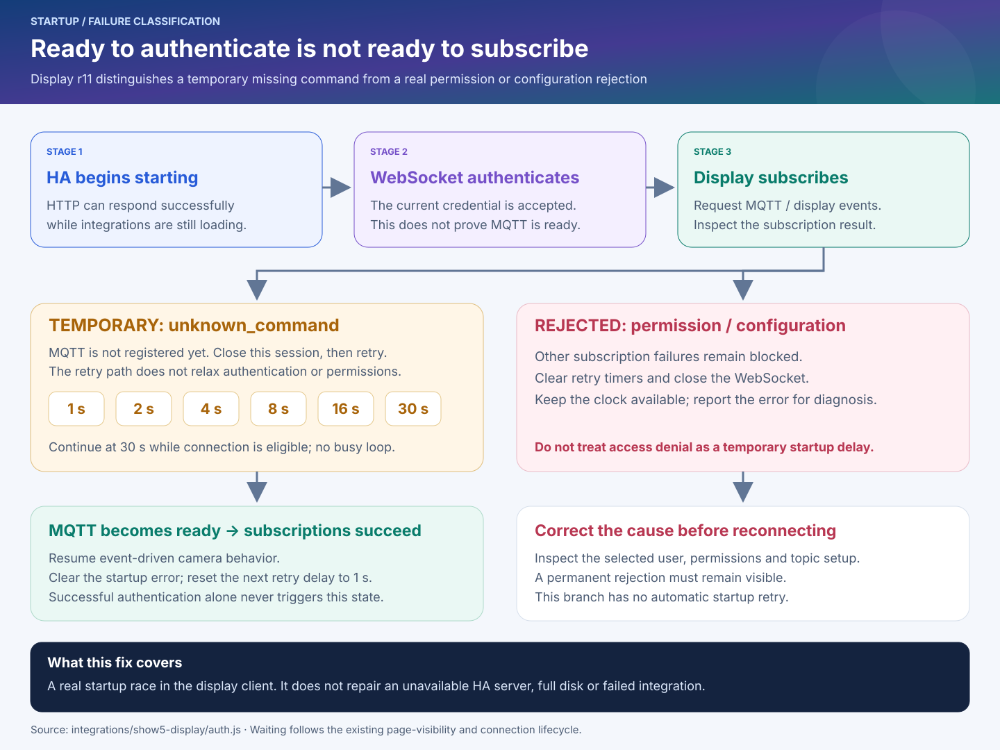
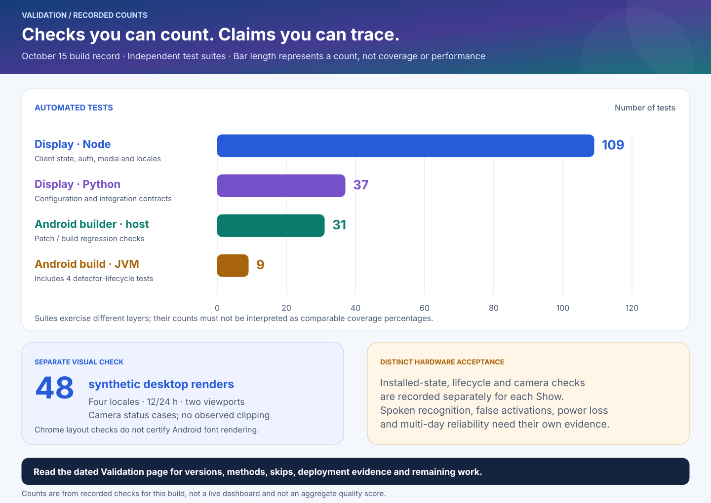

# Process and results

[Wiki home](Home.md) · [Validation and evidence](Validation.md) · [Architecture](Architecture.md)

**Current mixed activation:** [myshka.7](Mixed-wake-words.md) keeps the exact
Myshka path and adds optional bundled Hey Jarvis through the existing Stop
frontend. Show 1's installation, Android tests and microphone lifecycle have
[separate dated evidence](Validation.md#october-19-mixed-wake-checkpoint).
This page preserves earlier single-phrase and conversion observations; they
must not be relabeled as new build, device or acoustic results.

The project turns a supported **Echo Show 5 Gen2 (2021), `cronos`** into an Android room endpoint for Home Assistant. Firmware conversion happens once; the clock, voice client and integrations can then be updated independently. The October 15 work added two simultaneous wake models, fixes detector cleanup, localizes the clock interface and recovers from a specific Home Assistant startup race.

For the **October 16 exact ONNX model trial**, see [Wake model rollout: process and results](Wake-model-rollout.md). It has its own processing diagram, installation gates and development-evaluation chart. The two-phrase settings and installed results below are the dated October 15 baseline, not a universal current configuration.

## From stock hardware to a reusable endpoint

1. **Identify and prepare.** Verify the hardware model and full USB identity. Keep the normal AC adapter attached; USB alone is not the operating power source. Download the pinned, reviewed artifacts and preserve their hashes.
2. **Unlock and independently verify recovery.** Use the guarded amonet route, then confirm the expected TWRP state. A script exit code does not replace that probe.
3. **Verify a backup before formatting.** The first raw backup is necessarily after unlock. Copy and verify it off-device before formatting; it does not establish a tested universal stock-restoration method.
4. **Install and initialize Android.** Boot LineageOS 18.1, finish setup, authorize the intended debugging host and sign in to Home Assistant.
5. **Install and configure the voice client.** Preserve the satellite identity, app-private settings and signing material. The October 15 `dualwake.2` build ran the custom **“Привет, мышка”** model and built-in **“Hey Jarvis”** together at a shared **0.35** threshold. Both consume one microphone/frontend path.
6. **Deploy the room interface as a versioned release.** Install all clock assets together, including the language catalog, and update the intended home-page path. Keep the previous complete release available for rollback. Then verify the device's connection, model lifecycle, cameras and return to the clock.

Use [Installation and recovery](Installation-and-recovery.md) and the [full conversion runbook](../runbook.md) for operational commands and write gates. Updating an already converted device is not a reason to repeat unlock or formatting.

## What changed in this update

**VACA `0.13.4+dualwake.2` / version code `7002`** corrects detector resource cleanup during lifecycle changes. The same locally retained signing identity allows an in-place update from the preceding local build. The [dual-wake guide](../../integrations/vaca-dual-wake/README.md) records the patch, build receipt, secondary-model configuration and rollback procedure.

**Display `20261015-r11`** combines four UI language families—English, Russian, German and Spanish—with a fix for subscriptions during Home Assistant startup. The selected configuration remains **English with a 24-hour clock**. Changing `locale` or `hour12` changes the clock page; it does not translate upstream Android applications or select a different speech model. See [Localization](Localization.md).

Camera playback retains the full-screen, aspect-preserving view without clock or title overlays. The interface waits for presented video frames instead of treating a created player as proof of playback. The [display integration](../../integrations/show5-display/README.md) describes camera readiness, session expiry and cleanup in detail.

## The startup race and its recovery

A Home Assistant service can answer HTTP requests and accept a WebSocket credential while integrations are still loading. During the observed startup, the display could authenticate before the MQTT subscription command existed. The previous behavior treated this temporary `unknown_command` result like a permanent rejection, leaving the client without working subscriptions after the server recovered.

The r11 client now distinguishes the specific failure:

- **`unknown_command`:** close the current session and retry after 1, 2, 4, 8, 16, then 30 seconds. Further delays stay capped at 30 seconds while connection is eligible. A successful set of subscriptions clears the error and resets the next delay to one second.
- **Other subscription rejections:** clear timers, close the socket and retain the blocked/error state while keeping the clock available. Authentication and permission checks remain in force.
- **Hidden or disconnected page:** follow the existing connection lifecycle; the retry path is not an unrestricted background loop.

This fixes the client recovery behavior. It does not repair a full server disk or turn an HTTP health check into evidence that every HA integration is ready. For readiness, verify the relevant MQTT, Assist and VACA interfaces plus actual satellite/control states. [Troubleshooting](Troubleshooting.md) separates these layers.

## Verified results and remaining work

The October 15 checkpoint verified **VACA `dualwake.2` and display `r11` installed on both converted Shows**, with both activation models configured at **0.35**. English and 24-hour display formatting were retained.

On **both Shows**, three software microphone mute/unmute cycles and a normal app restart restored the two models and microphone capture. These are lifecycle observations; they do not prove spoken activation or audible answer quality.

**Fresh camera checks passed on both Shows:** Porch at 1920×1080 and Front at 854×480, followed by return to the clock. On Show 1, Porch needed an automatic second attempt after a startup timeout; an earlier attempt also failed signaling. Immediate startup and sustained reliability are not established. The revised check waits for the current stream to resolve and its frames to advance after clearing the previous camera. A nonzero historical frame count alone is not proof of current playback. See [Validation and evidence](Validation.md).

Physical recognition of both deliberately spoken phrases, false-positive behavior, power-loss recovery and a multi-day soak remain separate acceptance work. A normal app restart is not an Android reboot or removal of AC power. Jitsi, music and OTT playback also need their own end-to-end checks; launching an application alone does not establish a successful call or stream.

## Automated and visual evidence

The chart reports **counts**, not percentages of code coverage, a performance benchmark or a combined quality score. The suites cover different layers. The nine JVM tests include four detector resource-lifecycle cases; the 48 desktop renders separately exercise four locales, 12/24-hour clocks, two viewport sizes and camera status messages.

The rendered cases showed no clipping or clock wrapping. Desktop rendering does not establish every language's behavior on the Android device. Exact versions, methods, skipped checks and hardware limits belong in the [dated validation record](Validation.md).

## Local and cloud boundaries

Wake detection runs on the Show. The selected Russian Assist path still uses **cloud speech recognition**; local dialogue and local speech synthesis do not make that path fully offline. UI language, wake phrases and the selected Assist pipeline are independent settings. [Voice and wake words](Voice-and-wake-words.md) and the [voice-path diagram](../assets/voice-paths.svg) describe the available paths and switching procedure.

Private model files, device identities, credentials, recordings, downloaded firmware and raw diagnostic receipts stay outside the public source tree. The diagrams contain service roles and recorded public test counts, not household addresses or private content.
