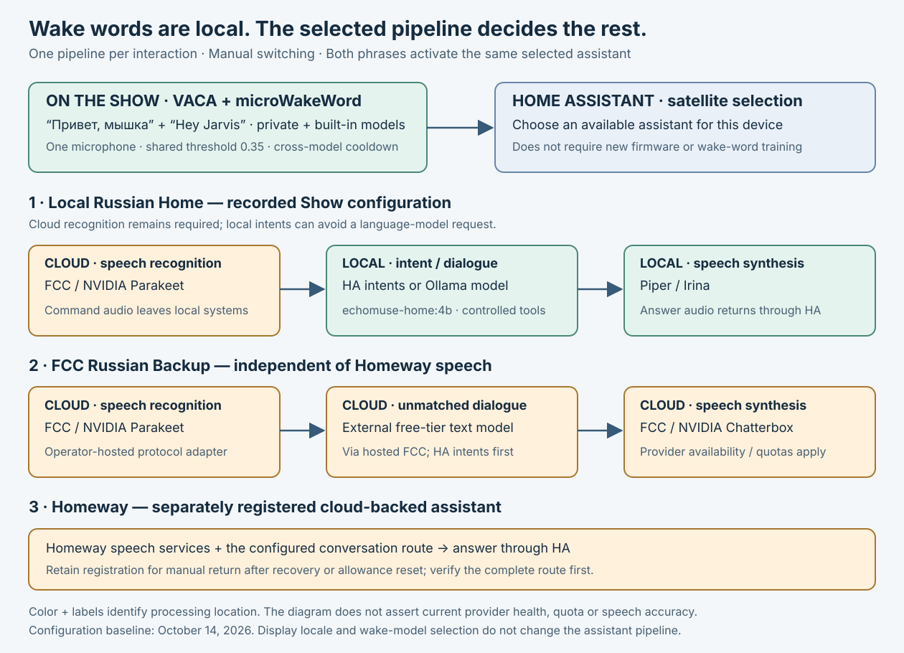

# Voice and wake-model choices

[Wiki home](Home.md) · [Wake-model rollout](Wake-model-rollout.md) · [Architecture](Architecture.md) · [Dual-wake implementation](../../integrations/vaca-dual-wake/README.md)

The wake detector decides **when to start listening for a command**. Speech recognition, intent/model processing and speech synthesis are separate HA stages. Changing a page's language or its displayed clock does not change any of those stages.

## October 16: opt-in single-phrase ONNX trial

**Build verified; device checks pending.** The candidate `0.13.4+myshka.3` / `7003` passed **18 JVM tests with no failures, errors or skips**. Its authorized trial configuration will use the updated **“Привет, мышка”** classifier as the only activation phrase, at **0.50** (**5.0 in HA**), with engine `openwakeword`. Remove the saved secondary selection so “Hey Jarvis” is not active. The exact ONNX path is opt-in; this does not remove the independent two-model microWakeWord capability.


The classifier is bound to the same ONNX frontend artifacts used during training. The **80 ms** value is a processing chunk, not a measured wake latency. Its **0.50** threshold and the earlier microWakeWord **0.35** belong to different models and cannot establish relative sensitivity by numeric comparison. The bundled Stop command reuses the same PCM and is not a second activation phrase.

Read the [rollout process and evidence](Wake-model-rollout.md) and [technical guide](../openwakeword-myshka.md) before installing or changing engine settings. Android installation, reference-output comparison and acoustic acceptance remain pending; the prepared reference fixtures are not successful device tests. This trial preserves the selected HA pipeline, display and media configuration and does not add a new recording task.

## Recorded two-word configuration

The October 15, 2026 `dualwake.2` deployment loaded the private **“Привет, мышка”** model and built-in **“Hey Jarvis”** on both converted Shows, through VACA's local microWakeWord extension. They share one microphone, a feature extractor, a **0.35** threshold and a two-second cross-model cooldown. Either phrase starts the same assistant selected for that satellite.

HA's primary-model selector still chooses the first model. The optional second selection is stored in VACA's **app-private** `files/secondary-wake-word.json`:

```json
{"id": "hey_jarvis"}
```

The selected identifier must exist in the active engine's model inventory. Restart VACA after changing the file. Disabling the primary disables both; a duplicate or unsupported secondary is not a second detector. Other wake engines keep single-model behavior. Use the [implementation guide](../../integrations/vaca-dual-wake/README.md) for current selection validation and build details.

HA's threshold control uses a 0–10 scale: **3.5 in HA means 0.35 in the detector**. Lowering it can improve sensitivity and also increase accidental activations. It is not a measured confidence guarantee. Keep model files private, retain their hashes, and use deliberate positive/negative phrase tests before choosing a new threshold. The Russian model is not bundled with this repository; its spoken phrase does not let another operator reconstruct the trained model.

## Choose and switch an assistant



The recorded device choice is **Local Russian Home**:

1. VACA detects the activation phrase locally.
2. HA sends command audio to **FCC Cloud Speech / NVIDIA Parakeet** for Russian recognition.
3. HA tries supported native intents first; unmatched dialogue uses the locally hosted `echomuse-home:4b` model through Ollama.
4. Local Piper generates **Irina** speech and HA returns it to the Show.

This is **not fully offline**. A cloud speech outage still affects recognition. There is no automatic cloud-language-model fallback for that local route. Supported home actions depend on HA exposure, intent handlers and the chosen conversation agent; a text-only general chatbot does not automatically gain household control.

Homeway and **FCC Russian Backup** can remain registered at the same time. HA chooses one pipeline per interaction. The independent FCC backup uses its cloud speech adapter and external text-model route; it does not need Homeway speech services. Read the [FCC guide](../fcc-voice-backup.md) for exact capability limits and [cloud audio](../fcc-cloud-audio.md) for transport and quota checks.

### During an outage or exhausted allowance

1. Record the affected Show's current **Assistant** selection. Inspect backend availability and run a harmless complete pipeline check, including fetching the answer audio. An entity marked available does not prove provider quota.
2. In that Show's HA device controls, select the already configured alternative. For Homeway exhaustion, choose the working FCC backup or local-dialogue route whose required speech service is healthy.
3. Re-read that satellite's selection, test a read-only question and a short announcement, and verify that the satellite returns to idle. Do not repeat a possibly executed household command merely because its response was lost.
4. When the original service recovers, verify it independently, restore the saved per-device selection, and repeat the bounded check. Retain the alternate integration for the next outage.

Do not change HA's global preferred pipeline to perform a single-device switch. A satellite's explicit selection can override that preference. Switching does not retrain wake words or require USB, APK replacement or new firmware.

The repository's [`voice_pipeline.py`](../../scripts/voice_pipeline.py) supports the named **homeway** and **fcc** backends with private mappings, dry-run previews and restore journals. Use the HA Assistant selector for **Local Russian Home**; do not relabel the third route as `fcc`. The [full switching runbook](../fcc-voice-backup.md#switch-one-or-several-satellites) contains exact commands and interrupted-operation behavior. There is no automatic failover.

## Acceptance and microphone coexistence

A model-load log and active unsilenced recorder establish deployment state. They do not prove that the selected phrase works from across the room. Record separate results for every active phrase, confirm that a removed alternative is inactive, and test near/far speech, negative phrases, background media and completion back to idle. Do not publish household audio or transcripts.

During a Jitsi call, follow the remote endpoint's microphone handoff. Home/Stop must restore the **previous** mute state, including an initially muted state. The display's camera viewer does not acquire a microphone. Avoid adding a second continuously listening application to solve a missing model; it can create capture contention without fixing the selected pipeline.

[Validation](Validation.md) lists the remaining physical tests. [Troubleshooting](Troubleshooting.md#voice-does-not-start-or-answer) separates failed activation from failed recognition or synthesis.
