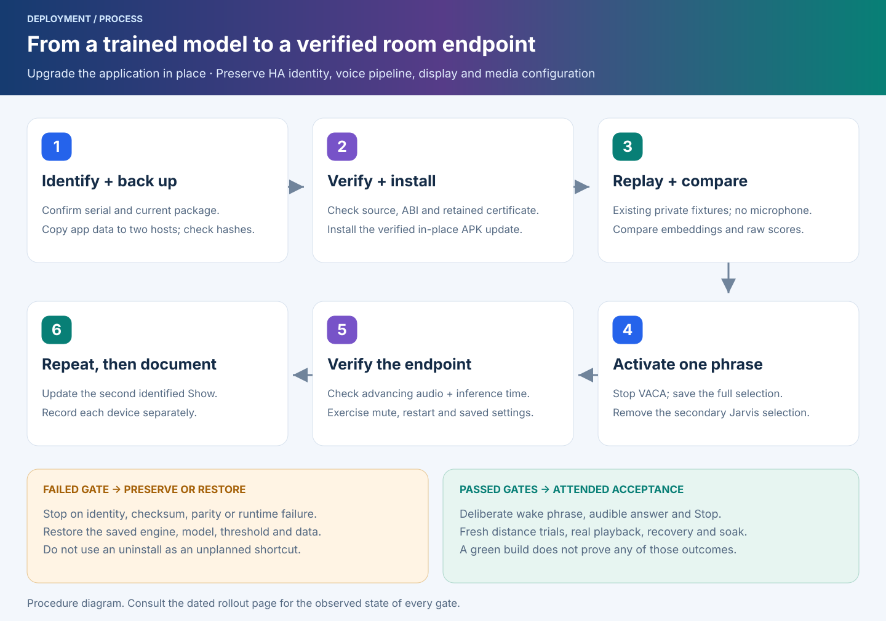
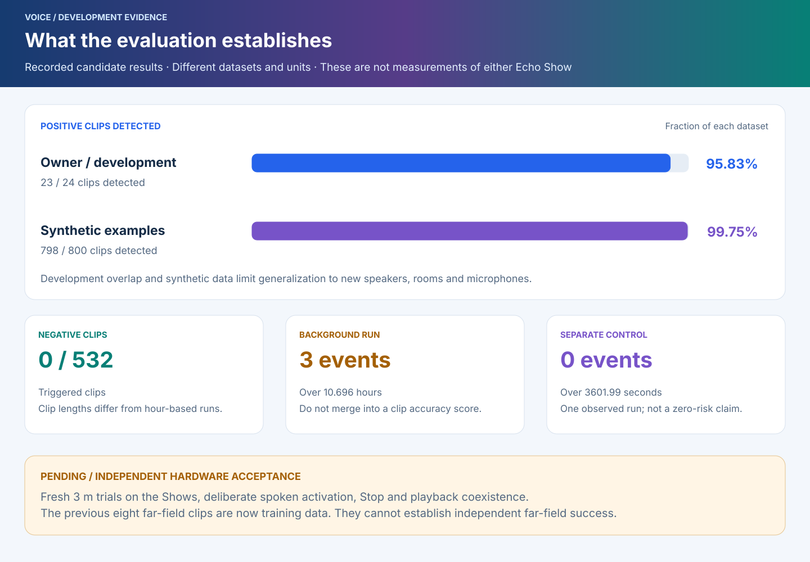

# Wake model rollout: process and results

[Wiki home](Home.md) · [Voice configuration](Voice-and-wake-words.md) · [Technical runbook](../openwakeword-myshka.md) · [Validation](Validation.md)

The October 16 work adds an exact ONNX feature pipeline for a privately trained **“Привет, Мышка” (Privet Myshka)** activation model. The intended configuration has one activation phrase. The bundled **Stop** command remains separate, consuming the same microphone samples. This page explains the change, the installation gates and what the evidence establishes.

**October 19 checkpoint:** Show 1 received the retained-key **`myshka.6` / `7006`**
update, with **29 JVM tests and three Android instrumentation tests passed**.
HTTPS authentication, the exact model and microphone inference were observed.
Show 2 is currently unreachable and remains last verified on `.4`. The
[dated validation record](Validation.md#october-19-current-checkpoint) includes
the current device and backend checks; physical speech acceptance remains pending.

**PR #69 follow-up: `myshka.4` / `7004` is built with the retained certificate and 18 passing JVM tests.** The [new build receipt](../../integrations/vaca-dual-wake/build-myshka.4.json) identifies the artifact. It prevents invalid optional metadata from breaking custom-model enumeration while preserving strict engine validation. Show 2 has the same-certificate `.4` update and passed the targeted Android inventory regression (one test, five metadata cases, 0.624 seconds); one actual microphone close/reopen cycle and a normal app restart also passed. Settings, brightness, permissions and authenticated nonroot ADB were preserved; end-to-end voice acceptance remains pending. At that October 16 checkpoint, Show 1 was unreachable and remained last verified on `.3`. The full `.3` replay below is not a claim of a new `.4` replay.

**Historical `.3` baseline: installed and verified on both Shows; physical speech acceptance pending.** VACA **`0.13.4+myshka.3` / `7003`** builds for ARMv7 with the retained signing certificate. Its **18 JVM tests pass without failures or skips**. Each Show independently passed Android numerical replay, three microphone mute/unmute cycles and a normal app restart. These results do not establish physical speech recognition. See the dated [build receipt](../../integrations/vaca-dual-wake/build-myshka.3.json) and device observations below.

The current [source builder](../../integrations/vaca-dual-wake/README.md) targets
`myshka.6` / `7006` with TLS and typed-input repairs. This page preserves the
`.3`/`.4` deployment history alongside the separate October 19 `.6` checkpoint.
Use the [`.6` build receipt](../../integrations/vaca-dual-wake/build-myshka.6.json)
and per-device results; earlier tests do not qualify a different artifact.

## Why the audio path changed

A classifier depends on the feature extraction used during training. The earlier microWakeWord model and the new ONNX model have different input contracts. Matching only the model filename or the spoken phrase is insufficient. The new implementation binds the classifier and both frontend artifacts to verified hashes and reproduces the streaming feature alignment.

In text: mono PCM at 16 kHz is accumulated into 1280-sample chunks with 480-sample context. The frontend maintains 76 × 32 mel features and supplies 16 × 96 embedding values to the activation classifier. It waits for real embeddings rather than random warmup. The raw score is compared against **0.50**, displayed as **5.0** by the HA control.

The **80 ms** chunk size describes audio framing, not the time until an answer. Actual delay also depends on phrase duration, buffering, inference, recognition, conversation and speech synthesis. A lower numeric threshold on a different model does not establish greater acoustic sensitivity.

## The installation process

1. **Identify and preserve.** Confirm the exact device and save its app-private state, previous signed APK and HA settings. Keep verified backup copies on two hosts.
2. **Build, inspect and install.** Verify the pinned source, complete patch, package, version, architecture and retained certificate. Apply the [same-certificate APK update](../../integrations/vaca-dual-wake/README.md#install-a-same-certificate-update) and confirm installed version `7004` before its regression checks. Retain the old wake selection until the required regression checks succeed.
3. **Run the checks appropriate to the change.** For an initial exact-frontend deployment or changed model assets, compare Android embeddings and scores with the reference using existing private audio fixtures. This reads files, not the room microphone. For `.3` → `.4` with the same verified assets, run the targeted inventory regression and update/lifecycle checks; keep the full `.3` replay recorded as historical evidence.
4. **Preserve a correct selection; stop VACA before changing it.** After the checks, first wait for the current app process to finish satellite initialization and advertise its fresh model inventory to HA. The `.3` → `.4` inventory-only update does not require HA selection writes when `openwakeword`, the manifest-bound model, threshold 5.0 and absent secondary selection are already correct. If any selection needs changing, stop VACA first, save the complete selection and remove the secondary-model selection before relaunching. Separate live writes can expose an empty model list and terminate the upstream listener. Use the option actually advertised by HA: this integration title-cases the model ID rather than using the manifest’s Russian label.
5. **Verify operation and preservation.** Observe advancing samples and classifier windows, measure processing time, exercise mute/unmute and app restart, and compare pipeline, permissions, screen and media settings.
6. **Repeat on the second device.** Treat each Show as its own result. Remove temporary fixture/test-app artifacts afterward and preserve private recovery material.

A failed gate requires diagnosis or restoration of the saved configuration. The [technical runbook](../openwakeword-myshka.md#rollback) covers rollback. Flashing firmware and uninstalling the working application are not routine steps in this upgrade.

## What the development evaluation says

The candidate's recorded evaluation detected **23/24 owner development clips** and **798/800 synthetic positives**. It triggered **0/532 negative clips**, with **3 events in 10.696 hours** of longer background material and none in a separate **3601.99-second** control. Clip counts and elapsed-hour experiments have different denominators; they cannot be combined into one accuracy percentage.

These observations concern the supplied development material. The earlier eight far-field clips are now training data. They do not establish independent far-field success, and microphone equivalence between a Dot and a Show is unverified. **Fresh three-metre trials remain pending.** Model weights, examples, recordings and detailed household receipts stay private.

## myshka.3 build results and device acceptance

The source build passed **18 JVM tests**: the previous nine selection/lifecycle cases plus nine new framing/state cases. The new cases cover fragmented reads, overlap, normalization, warmup, reset and buffer ownership. Both Shows independently passed the Android replay of **four existing private fixtures, 294 embeddings and 234 classifier windows**, including **11 positive reference windows**.

The separate Android instrumentation checks cover manifest integrity and full frontend/classifier replay. A numerical match proves compatibility for the exercised inputs. It does not prove deliberate wake recognition, intelligible answers, local Stop behavior during real playback, recovery from power loss or sustained reliability.

Runtime testing found that a quiet audio loop could prevent coroutine scheduling from delivering a mute change. The final candidate yields after each nonempty read so the listener can receive the change and close capture. Lifecycle verification checks actual microphone closure and recovery; a changed HA switch alone is not accepted as evidence.

### October 16 device observations

**Show 1 passed on the final candidate** whose APK hash is recorded in the linked build receipt. Both Android instrumentation tests passed: manifest validation plus replay. Its four fixtures produced 294 embeddings and 234 classifier windows, with all threshold decisions matching the reference, including 11 positive windows. Maximum absolute difference was 0.00007439 for embedding values and 0.000006885 for classifier scores. Replaying 23.520 seconds of existing test audio took 14.465 seconds, including per-fixture initialization.

Three software mute/unmute cycles each closed and restored capture; a normal app restart restored the same single model. Across those four ten-second runtime observations, inference processing averaged **53.8–56.0 ms per 80 ms of input**, including local Stop processing. This normalized processing time excludes time waiting for microphone input and is not end-to-end voice latency or a long-duration benchmark. Some microphone reads contain multiple chunks; a peak read duration must not be interpreted as a single 80 ms chunk's processing time.

**Show 2 independently passed the same checks on the same APK.** Both instrumentation tests passed, with the same embedding/window counts, threshold decisions and maximum numerical differences. Replaying the same 23.520 seconds of test audio took **14.634 seconds**, including per-fixture initialization. Three mute/unmute cycles each closed and restored capture, followed by a successful normal app restart. Mean inference processing per 80 ms of input was **54.7, 55.3 and 53.7 ms** after the three cycles, and **57.2 ms** after restart. These are short observations under the tested conditions, not a guarantee under every workload.

Both Shows now have one selected activation classifier at **0.50** and no secondary Jarvis selection. Existing HA identities, assistant selection, display/media settings and permission choices were preserved. Display revision `20261015-r11`, English 24-hour time and manual full brightness were retained. Authenticated nonroot ADB remained available; diagnostics were disabled. The preceding installed `dualwake.2` baseline remains in the [October 15 record](Validation.md#october-15-installed-state-and-recovery-checks).

On both Shows, cleanup removed the temporary fixture directory and instrumentation APK, re-verified the four private model/manifest files and confirmed the application was still running. Private recovery backups were retained off-device.

**Still pending:** deliberate spoken activation and audible answers, Stop during playback, fresh three-metre trials, Android reboot/power-loss recovery and longer observation. No new microphone recording was collected, and no change to the selected STT, conversation or TTS provider was required.

## myshka.4 follow-up

The `.4` Android regression covers malformed optional JSON, a missing frontend and an asset mismatch. Model inventory must retain generated-label entries while exact-engine loading still rejects invalid assets. Show 2 passed the targeted Android test in 0.624 seconds, covering five metadata cases, after installing the same-certificate `.4` update. Show 2 also passed **one actual microphone close/reopen cycle** and a **normal app restart**. Observed processing times were **52.960 ms per 80 ms input chunk** after the cycle and **55.184 ms per 80 ms** after restart; these are short local processing observations, not wake or response latency. The single model at 0.50, absent secondary selection, HA configuration, manual brightness 255, permissions and authenticated nonroot ADB were preserved. End-to-end HA/TTS health and physical speech acceptance were not tested. At that October 16 checkpoint, Show 1 remained last verified on `.3` and had not been updated because it was unreachable.

Final cleanup confirmed that the temporary fixture directory and instrumentation APK are absent, all four private model/manifest assets still match their expected hashes, and VACA remains running.

The existing full fixture replay, timing measurements and three-cycle lifecycle tests above belong to `.3`. They are not silently re-attributed to `.4`. A targeted inventory regression or ordinary app update does not remeasure acoustic quality.

## Language and service boundaries

The screen's four UI language families and the five README entry languages remain independent of wake phrases and speech language. The selected Russian Assist path still uses cloud recognition. Updating the local activation model does not move recognition on-device or switch the conversation provider. See [localization](Localization.md) and [voice paths](Voice-and-wake-words.md#choose-and-switch-an-assistant).

The diagrams are editable, self-contained SVG source. Their labels use canonical English, with explanatory text available through the translated project entry points. They contain no household addresses, credentials or device identifiers.
