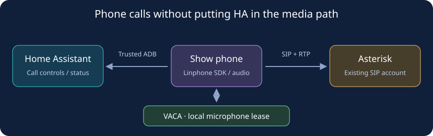

# Native SIP audio endpoint

This optional application turns an already converted Android 11 ARMv7 Show into
a SIP audio endpoint. It uses the operator's existing PBX and a pinned Linphone
SDK. It does not provision a PBX, allocate telephone numbers, change firmware,
or replace Jitsi. All phone controls and Home Assistant labels are English.



## Components

- `android/`: the **Show phone** application (`org.hahomelab.show5sip`). A
  foreground service registers with the PBX. Calls require an explicit user or
  authenticated administrator action; incoming calls ring without answering.
- [VACA bridge](vaca-bridge/README.md): an additive, same-signer Binder service
  for the exact `.9` source. It grants audio only after VACA's recorder teardown
  completes and restores listening after native call media closes. It does not
  overwrite the user's mute setting.
- [HA controls](home_assistant/README.md): registration/call sensors, allowlisted
  contact buttons, Answer, Decline and Hang up through the existing authenticated
  Android Debug Bridge integration. HA is not in the RTP media path.
- [Pinned SDK](linphone-artifact.json): the exact official Android library,
  including digest and ARMv7 evidence. The isolated Android application is
  **AGPL-3.0-only**; see its [license](android/LICENSE) and [notice](android/NOTICE).
  This does not relicense unrelated repository components.

## Build without connecting a device

Use JDK 21, Android platform/build tools 36 and Gradle 9.4.1. The two applications
must use the **existing VACA signing identity**. Neither build script creates or
replaces a key. A different signer cannot acquire the local audio lease.

```sh
python3 integrations/show5-sip/build_vaca.py \
  --work-dir /absolute/private/vaca-sip-build \
  --signing-dir /absolute/private/retained-vaca-signing \
  --expected-signer-sha256 YOUR_VERIFIED_EXISTING_CERTIFICATE_SHA256

python3 integrations/show5-sip/build.py \
  --work-dir /absolute/private/sip-build \
  --signing-dir /absolute/private/retained-vaca-signing \
  --expected-signer-sha256 YOUR_VERIFIED_EXISTING_CERTIFICATE_SHA256 \
  --gradle /absolute/path/to/gradle
```

Set `JAVA_HOME` and `ANDROID_HOME` before running either command. The VACA builder
can use an existing local Git object cache through `--source-cache`, while still
checking the pinned upstream commit, `.9` patch and every bridge source file.
The SIP builder verifies the SDK's size, SHA-256 and ARMv7 libraries before use.
Both write separate APK/JSON receipts and private build logs. Source changes
during a build invalidate the result. Generated artifacts and credentials stay
outside the public source distribution.

## Install and provision one endpoint

1. Independently match the full hardware serial, `cronos`, Android 11 and secure
   nonroot ADB. Confirm no existing call or media session is active.
2. Save a consistent stopped-app VACA backup, the current APK, settings and signer
   receipt. Keep a verified copy away from the device. Use an ordinary same-signer
   APK update; never uninstall VACA to work around a signer mismatch.
3. Install the verified VACA bridge build, then the signed Show phone release.
   Grant the phone application Microphone permission. It requests no Camera
   permission. Restore the normal VACA home screen after setup.
4. Ask the PBX owner for a distinct account, exact source-address ACL and allowed
   destinations. Copy [the example](configuration.example.json) into a private
   file with mode `0600`; replace every placeholder. All contact addresses must
   use the configured PBX host and port. The initial media list is G.722, PCMU,
   PCMA; the actual negotiated codec depends on both endpoints.
5. Validate/import through the existing trusted ADB connection:

```sh
python3 integrations/show5-sip/provision.py validate --config /private/show-phone.json
python3 integrations/show5-sip/provision.py apply \
  --config /private/show-phone.json \
  --target EXACT_ADB_TARGET --expected-serial FULL_VERIFIED_SERIAL
python3 integrations/show5-sip/provision.py status \
  --target EXACT_ADB_TARGET --expected-serial FULL_VERIFIED_SERIAL
```

The importer sends credentials on standard input to a write-only, DUMP-protected
Android provider. It never places them in command arguments, shared storage,
public HA assets or status. A matching configuration digest acknowledges the
import; `registered` separately acknowledges the SIP account. Neither proves a
successful call. Reconfiguration is refused while a call or audio lease exists.

## Call lifecycle

Outgoing calls select a provisioned contact ID. Incoming calls have separate
Answer and Decline actions. Both dial and answer wait for a local VACA lease
grant; timeout or rejection must not open the microphone. HA brings the phone
activity to the foreground before those actions on Android 11.

Every call gets its own identifier. Hang up and Decline must match that identifier;
old commands cannot end a replacement call. Repeated command UUIDs do not repeat
a dial. Local hangup, remote hangup, failed dialing, cancellation and the maximum
call duration all terminate native SIP media before releasing the VACA lease.
The default call bound is 120 seconds, configurable from 10 to 1800 seconds.

The lease uses a heartbeat independent of Home Assistant. A missing heartbeat
revokes the grant but does not by itself prove that a living client stopped
capturing audio. VACA waits for release acknowledgement or client Binder death.
Both applications retain enough private state to reconcile process restarts.
An unreadable journal stays visibly blocked rather than guessing that it is safe
to resume. The incoming-call screen returns to VACA's clock after cleanup; an
explicitly opened phone menu remains open.

## Read call diagnostics without recording

The DUMP-protected, read-only `/diagnostics` provider exposes sanitized metadata
from the pinned Linphone SDK. It is separate from `/status`; the existing HA
status contract is unchanged. Reading either endpoint does not start a service,
place a call, open the microphone or invoke native SDK operations.

Replace the placeholder with the independently verified ADB serial. During an
explicitly initiated, bounded test call, read the current state and metadata:

```sh
DEVICE_SERIAL='replace-with-verified-device-serial'
adb -s "$DEVICE_SERIAL" shell content query \
  --uri content://org.hahomelab.show5sip/status
adb -s "$DEVICE_SERIAL" shell content query \
  --uri content://org.hahomelab.show5sip/diagnostics
```

Both queries return one `json` column (`Row: 0 json={...}`). The diagnostics
object has these fields:

- `schema`: integer `1`.
- `call_id`: the application's call UUID, matching `/status` while that call
  exists, or `null`. This is not the SIP protocol's Call-ID header.
- `audio_codec`: `G722`, `PCMU`, `PCMA` or `null`.
- `clock_rate` and `channels`: negotiated RTP payload clock in Hz and channel
  count, or `null` when unavailable.
- `upload_kbps` and `download_kbps`: finite, nonnegative bandwidth measurements
  in kbit/s, including IP/UDP/RTP headers, or `null` when unavailable.
- `ice_state`: `NotActivated`, `Failed`, `InProgress`, `HostConnection`,
  `ReflexiveConnection`, `RelayConnection` or `null`.
- `retained`: whether the call has ended and this is its last cached snapshot.
- `samples`: number of accepted SDK metadata updates, not an RTP packet count.
- `sample_age_ms`: elapsed monotonic milliseconds since the latest accepted
  update, or `null` before any update.

Measurements come from `CoreListener.onCallStatsUpdated` and
`Call.getAudioStats()` for the current call's audio stream. Negotiation details
use `Call.getCurrentParams().getUsedAudioPayloadType()` and the payload's
`getMimeType()`, `getClockRate()` and `getChannels()`. Bandwidth and ICE use
`CallStats.getUploadBandwidth()`, `getDownloadBandwidth()` and `getIceState()`.
These methods were checked against the pinned 5.5.39 SDK sources.

G.722 can correctly report `clock_rate: 8000` while carrying 16 kHz wideband
audio: this field is the RTP timestamp clock, not the audio sampling rate.
`NotActivated` can be normal for a direct LAN call without ICE. Neither field
alone establishes a fault. Unknown measurements remain `null`, not zero.

After hangup, repeat the diagnostics query to inspect the last snapshot with
`retained: true`. It is held only in memory; its age continues to increase. A new
call clears the previous measurements and sample count, and a process restart
clears the cache. Updates belonging to an old call cannot change a new or
retained snapshot. No audio is recorded, and no SIP addresses, credentials,
contact labels or media contents are included.

These counters can help check codec negotiation and traffic in both directions.
They do not prove that the microphone is unsilenced, speech is intelligible, the
speaker is audible or echo cancellation is adequate. Verify those separately
with consenting participants; a successful build is not a live-call result.

## Scope and acceptance

This is an **audio-only pilot**. Video initiation, video auto-accept and Camera
permission are disabled, including remote video upgrades. Android IP Camera and
the existing Jitsi installation retain their settings.

The VACA lease is not an Android-wide microphone lock. Legacy Jitsi/intercom
launchers do not participate in it. Do not start those applications during a SIP
call; coordinating every existing launcher remains a separate integration task.
The application does not claim that two call applications can share a microphone.

Before daily use, record separate results for registration, negotiated codec,
RTP in both directions, audible two-way sound, incoming Answer/Decline, cancellation,
remote/local hangup, call timeout and VACA restoration. Repeat with VACA initially
muted and unmuted. Process-death and network-loss checks must end with no remaining
call or microphone lease. Keep packet contents and household audio out of reports.
Builds and synthetic tests do not establish acoustic quality or unattended uptime.

Offline checks:

```sh
python3 -m unittest discover -s integrations/show5-sip/tests -v
python3 -m unittest discover -s integrations/show5-sip/home_assistant/tests -v
```

The Android builders additionally run JVM tests before validating APK identity.
The native SIP application has **19 passing JVM tests**: ten for provisioning,
four for lease reply matching and five for diagnostic sanitization, retention
and call isolation. These are offline tests, not device or acoustic acceptance.
The builders never install applications or place calls.

To remove the pilot, first hang up, verify the phone is idle and its lease is
released, then stop its registration and disable its HA entry. Preserve the
existing VACA settings and signed backup; do not delete an active lease journal
or force microphone capture while a call process may still be alive.
